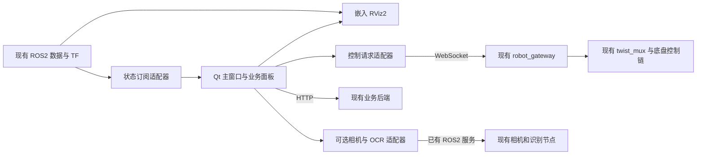

# Qt / RViz2 桌面端移植分析报告

分析日期：2026-10-15。源界面：`/home/jkbot/Ros_Qt5_Gui_App`；目标项目：`/home/jkbot/Remote_ctrol`。本次只做源码分析、依赖检查和方案设计，没有执行移植、安装依赖、启动导航或下发车辆指令。

## 1. 结论

**可以移植，也可以将对现有代码的影响控制在很小的范围。建议新增独立的 Qt5 桌面应用，嵌入真正的 RViz2，作为现有 ROS2 系统的另一个操作入口。**

建议遵循以下边界：

- 新增 `desktop_ui/`，独立构建、独立启动；不要求修改已有 ROS2 工作空间构建脚本、网页、定位、导航或底盘源码。
- 复用旧 Qt 的窗口布局、停靠面板、资源和适用的控件；中央地图区换成 RViz2，通信和启动管理在新副本中适配。
- 地图、雷达、点云、TF 等直接通过 ROS2 显示；遥控、急停、目标点、取消导航等优先走现有网关，保持与网页相同的控制链路。
- 默认连接已启动的系统；进程启动管理作为后续能力，只管理桌面端自己启动的进程。
- 首版先完成显示与单点操作；多点循环、无人值守巡检、精确停靠和智能掉头分别处理，避免把算法和业务执行器塞进窗口程序。

这里的“解耦”指源码、构建、启动和故障边界独立。显示点云会消耗计算和网络资源，操作同一辆车也必然共享控制状态，因此仍需性能验证，并限制多个界面同时操控。关闭或不运行桌面端后，原有使用方式应保持可用。

## 2. 旧 Qt 项目有哪些可以复用

旧项目已经包含 ROS1、ROS2 通信通道，并非完全从 ROS1 开始重写。但当前机器人业务按钮、相机和仪表展示明显依赖旧 ROS1 环境。

| 部分 | 实际情况 | 移植建议 |
| --- | --- | --- |
| 主窗口、停靠面板、图标和样式 | Qt5 / C++17 桌面程序 | 在新目录复制、复用 |
| 中央地图 | `DisplayManager` 自绘二维地图，没有嵌入 RViz | 替换为 RViz2 容器 |
| ROS2 通信 | 已有地图、扫描、路径、里程计、目标点等基础接口 | 拆成显示数据适配与命令适配，补齐生命周期和 QoS |
| 建图、导航、巡检按钮 | 硬编码调用 `/home/jkbot/catkin_ws/src/run/*.sh` | 在新副本中改为配置化 ROS2 模式 |
| 停止进程 | 读取 `/tmp/launch_pid_*.txt` 并执行 `kill` | 替换为只管理本应用子进程的机制 |
| 任务表、多点循环 | 在界面线程体系内串发目标，按误差判断到达 | 保留表格外观，重做执行接口；首版不启用旧执行逻辑 |
| 相机、仪表识别展示 | ROS1 侧接收图片路径与识别文本 | 接入本项目海康相机和 OCR 接口 |
| 电池、识别初始值 | 有固定 `50% / 24.9V`、`0.0` 展示值 | 改为真实数据或明确“未接入 / 已过期” |

特别需要注意：旧任务表使用 `0.1m / 5°` 阈值，并不代表车辆已经能达到这个停车精度。它没有以 Nav2 动作结果判定成功，停止任务表也只停止后续派发，不会取消正在执行的导航；后台任务还直接操作界面控件。这部分不能直接搬来承担实车巡检。

依据：[旧主窗口](/home/jkbot/Ros_Qt5_Gui_App/mainwindow/src/mainwindow.cpp:777)、[旧任务表](/home/jkbot/Ros_Qt5_Gui_App/mainwindow/src/widgets/nav_goal_table_view.cpp:99)、[旧 ROS2 通信](/home/jkbot/Ros_Qt5_Gui_App/channel/ros2/rclcomm.cpp:13)。

## 3. 目标项目已有接口与接入方法

| 功能 | 当前可复用接口 | 桌面端适配方式 |
| --- | --- | --- |
| 地图、扫描、点云、代价地图、路径 | ROS2 话题、TF、现有 `.rviz` | RViz2 直接订阅，按模式配置 |
| 车辆位姿 | `map → base_link` 或建图模式对应 TF | 按模式读取，显示坐标系和有效状态 |
| 速度显示 | `/odom`；FAST-LIO 自身还发布 `/Odometry` | 明确数据来源，区分指令与反馈 |
| 手动行驶 | 网关 WebSocket `cmd_vel` | 复用网关限幅、看门狗和速度仲裁 |
| 急停、取消导航 | 网关 `estop`、`nav_cancel` | 共用现有控制入口 |
| 初始定位、单点导航 | 网关 `initial_pose`、`nav_goal` | Qt 数值输入和 RViz 点选都转为同一类请求 |
| 点位、路线、计划、记录 | 后端 `/api/points`、`/api/routes`、`/api/plans` 等 | HTTP 访问，复用后端数据 |
| 业务抓拍、播报、播放音频 | 网关 `capture`、`tts`、`audio_play` | 复用现有业务链路 |
| 海康视频、云台、相机抓拍 | `/hk_camera/image_raw`、`/hk_camera/set_ptz_pose`、`/hk_camera/capture` | 可选相机适配模块 |
| OCR | `/ocr/recognize`，可选 `/ocr/result` | 默认按需识别；流式结果仅在启用流式时订阅 |
| 电池 | 驱动中有 `/battery_status`，类型为 `yunle_msgs/msg/Battery` | 在桌面端适配实际反馈；不能直接沿用旧 `/battery` 的标准消息订阅 |

当前网关默认使用 WebSocket `8765`，业务后端使用 HTTP `8888`；实际地址应来自桌面端配置，避免硬编码。桌面端不直接访问后端 SQLite，也不另存一套与网页互不关联的点位、路线和计划。

主要依据：[网关实现](ros2_ws/src/robot_gateway/robot_gateway/gateway_node.py)、[速度仲裁](ros2_ws/src/chassis_nav2/config/twist_mux.yaml)、[点位接口](backend/api_points.py)、[巡检计划接口](backend/api_plans.py)、[相机节点](ros2_ws/src/hk_camera/src/hk_camera_node.cpp)、[OCR 节点](ros2_ws/src/ocr_node/ocr_node/ocr_node.py)。

## 4. 推荐架构



窗口层只处理展示和交互；通信层负责消息转换、连接、超时和状态；运行管理层负责模式与子进程。定位和导航算法仍在现有 ROS2 节点中运行。

不需要先开发通用插件框架。用少量明确的接口隔开状态读取、控制请求、相机/OCR、地图会话即可。将来更换导航算法或加入掉头行为时，桌面端主要增加状态展示和操作入口。

### RViz2 如何嵌入

推荐封装 `RvizHostWidget`，内部使用 `rviz_common::VisualizationFrame`。它可以加载 `.rviz`，保留显示项、视角和工具等能力，比只嵌入渲染画布更符合“直接使用 RViz”的要求。本机头文件及 [RViz2 Humble 官方源码](https://raw.githubusercontent.com/ros2/rviz/humble/rviz_common/include/rviz_common/visualization_frame.hpp)提供了初始化、配置加载和管理器访问接口。

这是 Qt 组件嵌入，不需要把外部 `rviz2` 进程的窗口强行挂进来。需要验证嵌套窗口布局、配置切换以及关闭顺序；RViz 的渲染异常最多影响桌面进程，已有导航节点仍保持独立进程。

还需处理两个细节：

1. `.rviz` 不仅包含显示项，也可能包含窗口几何、工具和面板。桌面端使用自己的配置副本，不覆盖原配置，并防止加载配置改变外层窗口布局。
2. RViz 默认目标点工具或 Nav2 面板可能直接发送 ROS 目标。这会绕过网关，使网关持有的目标句柄与实际导航不一致。标准操作模式应将点选请求送到桌面端内部接口，再转网关；默认不加载直接控制导航的面板。可通过专用点选工具，或将工具话题配置到桌面端专用请求话题实现。

## 5. 建议目录和代码边界

以下为后续实施结构，本次尚未创建应用目录：

```text
Remote_ctrol/
├── desktop_ui/                    # 新增，独立桌面端
│   ├── CMakeLists.txt
│   ├── COLCON_IGNORE              # 避免被项目根目录的递归构建意外纳入
│   ├── README.md
│   ├── LICENSE                    # 保留源项目许可及来源说明
│   ├── src/
│   │   ├── ui/                    # 从旧 Qt 迁移的窗口与控件
│   │   ├── rviz/                  # RViz2 容器与点选适配
│   │   ├── adapters/              # ROS 状态、WebSocket、HTTP、相机/OCR
│   │   └── runtime/               # 模式与进程管理
│   ├── resources/
│   ├── third_party/               # 旧 Qt 必需的第三方源码及许可
│   ├── config/                    # 默认配置、模式定义和 RViz 配置副本
│   └── scripts/
│       ├── build.sh
│       └── run.sh
├── ros2_ws/                       # 维持现有职责
├── backend/                       # 维持现有职责
├── web/                           # 维持现有职责
└── scripts/                       # 原有启动方式保持可用
```

建议独立使用 CMake 构建桌面端，复用已安装的 ROS2 和本项目消息包，不把整个 Qt 工程塞进某个导航包。不复用旧 Qt 的 `build/`，也不复用原项目的 `ros2_ws/build/`、`install/` 输出目录。

迁移时复制源码、界面资源及必要第三方依赖，保留旧项目根目录的 GPLv2 许可文本和第三方许可；排除 `.git`、构建产物、缓存、IDE 文件和旧运行数据。只修改新副本，原 `/home/jkbot/Ros_Qt5_Gui_App` 保持原状。

用户配置和日志使用桌面端自己的运行目录。项目路径按可执行文件位置或 `ROBOT_PROJECT_ROOT` 解析，ROS 包资源通过 ament 索引定位，不依赖启动时恰好位于哪个目录。

## 6. 三套建图 / 导航怎样共用界面

显示后端由配置决定。切换 RViz 显示配置和切换实际运行算法是两件事，界面必须分别表达。

| 模式 | 现有入口 | 显示配置参考 | 固定坐标系 |
| --- | --- | --- | --- |
| SLAM Toolbox 建图 | `slam_2d_mapping.launch.py` | `chassis_nav2/config/slam.rviz` | `map` |
| SLAM Toolbox 定位与导航 | `slam_2d_localization.launch.py` | `chassis_nav2/config/localization_nav.rviz` | `map` |
| Cartographer 建图 | `cartographer_2d_mapping.launch.py` | `chassis_nav2/config/slam.rviz` | `map` |
| Cartographer 定位与导航 | `cartographer_2d_localization.launch.py` | `chassis_nav2/config/localization_nav.rviz` | `map` |
| FAST-LIO 建图 | `fastlio_mapping.launch.py` | `FAST_LIO_LOCALIZATION_ROS2/rviz/fastlio.rviz` | `lio_odom` |
| FAST-LIO 定位与 Nav2 导航 | `navigation.launch.py` | `chassis_nav2/config/localization_nav.rviz` | `map` |

三套定位后端运行时三选一，避免多个节点同时发布相同 TF 或启动重复驱动。嵌入 RViz 后，相关启动参数设为 `rviz:=false`。根据当前模式只启用实际存在的显示项，检查话题类型、QoS、时间戳和 TF，不能把所有旧显示项都启用后将无数据误报为导航失败。

当前源码中还有这些运行条件：

- 两套二维建图入口默认 `start_nav2:=false`，建图以遥控为主；显示建图并不表示已具备目标点导航。
- 各入口底盘、控制桥的启用参数需遵循现有实车配置。`fastlio_mapping.launch.py` 明确关闭底盘及控制桥启动，不能因为界面有方向按钮就认定车辆控制链已启动。
- 导航时继续使用现有里程计、硬件配置和 Nav2 参数；桌面端不擅自改变 `odom_source`、车体轮廓、转弯半径等。
- 当前 FAST-LIO 路线使用点云定位并结合二维栅格 Nav2。RViz 显示三维点云不等于增加了三维路径规划算法。

### 地图保存需要按后端分别适配

| 后端 | 应保存的内容 | 桌面端要补的工作 |
| --- | --- | --- |
| SLAM Toolbox | 用于导航的 YAML/图像，以及用于后续定位的序列化图数据 | 分别调用相应存图、序列化接口，确认两类文件成功 |
| Cartographer | `.pbstream` 状态，以及 YAML/栅格图 | 按当前轨迹完成状态保存、栅格导出，并检查产物 |
| FAST-LIO | PCD；需要二维导航时再做同坐标栅格转换 | 调用已有 `/map_save`，再接现有 `pcd2pgm` / `map_saver_cli` 流程 |

不能沿用旧 Qt 的“停止三维建图进程就算保存成功”。保存应异步执行，检查响应与产物后再决定结束会话。二维服务的实际名称和参数需在联调时按已安装包与运行节点核对，现有 launch 也没有统一的三后端存图服务。

FAST-LIO 的 PCD、导航 YAML/PGM、网页地图必须保持同一坐标关系。不同地图上的点位也不能直接混用：当前点位 API 没有地图 ID，首版需限制到当前明确选择的地图；完整多地图点位管理需要后续补充数据模型，不能仅靠切换显示实现。

依据：[二维管线](ros2_ws/src/chassis_nav2/chassis_nav2/bringup_2d.py)、[FAST-LIO 建图入口](ros2_ws/src/chassis_nav2/launch/fastlio_mapping.launch.py)、[统一入口](ros2_ws/src/chassis_nav2/launch/bringup.launch.py)、[地图转换与导出说明](实机导航移植说明.md)。

## 7. 控制链与并发操作是解耦的关键

目前控制链为：

```text
网页 / 新 Qt → robot_gateway → /cmd_vel_teleop → twist_mux → /cmd_vel → 既有底盘控制
Nav2                       → /cmd_vel_auto   ↗
既有末端控制               → /cmd_vel_final  ↗
robot_gateway              → /emergency_stop → 仲裁锁
```

新 Qt 不直接发布底盘最终速度、`/ecu` 或第二路急停状态，不另启动一份网关。否则会出现控制竞争，削弱“与网页使用同一套规则”的效果。

按当前网关源码，实施时必须处理以下约束：

| 已有行为 | 桌面端要求 |
| --- | --- |
| 每次 `cmd_vel` 都会解除网关急停状态，零速度也一样 | 不发送空闲零速度心跳；重连不自动发速度；仅在明确手动操作期间下发 |
| 手动速度优先级高于导航 | 接管手动控制前取消导航并核实状态，防止手动输入超时后旧导航恢复 |
| 断开 WebSocket 不立即清除上次速度 | 松键、失焦和正常退出主动结束本次手动输入；异常断线依赖现有看门狗，需实测停止时间 |
| `cmd_timeout` 当前配置为 1 秒，之后还有零速度保持期 | 联调必须核实可接受的失联响应，不能宣称断线即时停车 |
| 网关只持有自己发出的导航目标句柄 | 所有常规导航入口统一走网关，包括 RViz 点选 |
| 多客户端共用命令与导航状态，没有控制权租约 | 可同时监视，实车操作阶段一次只用一个控制前端；Qt 本地观察模式不能阻止网页发指令 |
| 遥测缺少目标 ID、客户端 ID 和命令确认关联 | 首版限定单目标操作；完善多点执行前需补齐可靠的目标关联机制 |
| 网关遥测依赖里程计、扫描与 TF，且未携带急停字段 | 连接状态、定位有效性、急停等分别判断；不能以 WebSocket 已连接代表系统全部就绪 |

因此，“尽量不改原代码”适用于第一阶段接入。如果要求网页和 Qt 在服务端强制互斥控制，或要求可靠的多目标业务执行，需要另行扩展网关/执行器；仅修改 Qt 无法给所有客户端建立共同约束。

速度相关数值继续遵循当前 ROS2 接口：线速度用 m/s，角速度用 rad/s；实际前后轮转角属于另一类反馈，不能把 `Twist.angular.z` 直接标成“转向角”。命令速度、实际速度和真实转角应分别标注，这也有助于后续分析掉头时指令与底盘响应的差异。

## 8. 在新副本中必须修复的兼容问题

| 问题 | 处理建议 |
| --- | --- |
| 旧 ROS2 通道自行 `rclcpp::init()`、`shutdown()` | 整个桌面进程统一初始化和退出；避免通道重连时关闭嵌入的 RViz |
| 通道启动、后台处理早于数据回调注册 | 先建立回调再启动执行器，退出时停止回调、等待线程并释放资源 |
| Qt 窗口与 ROS 回调线程混用 | ROS 线程只处理数据，经队列信号更新界面；RViz 渲染与控件操作留在 GUI 线程 |
| 扫描等订阅沿用默认可靠 QoS | 按实际发布端匹配，地图使用合适的持久性，传感器流匹配 SensorData QoS |
| TF 查找失败仍返回默认位姿 | 数据模型携带有效性、坐标系和时间，失效时不展示为车辆回到原点 |
| 电池字段 `percent` / `capacity` 不一致，消息类型也不一致 | 统一界面数据模型并核对百分比、单位与新鲜度 |
| 通道自动加载 `./lib/` 中首个匹配库 | 固定使用适配后的 ROS2 通道，不自动选到 ROS1 或其他旧库 |
| 配置依赖 `./config.json`，会自动写默认值 | 显式独立配置路径，不写项目根目录的配置文件 |
| 按钮执行固定绝对路径脚本，停止依赖共享 PID 文件 | 模式配置传入程序和参数，记录自身进程组；不使用旧 PID 文件 |
| 图片通过机器人本地绝对路径加载 | 同机可读文件；远程使用服务返回图像或后端可访问资源地址 |

建议首先支持 Qt 与机器人同机运行。若在另一台电脑运行，RViz 仍需要可用的 ROS2 DDS 网络、匹配的环境和消息包；只连接 WebSocket 并不能获得完整 RViz 数据。跨网视频及地图文件管理也需要单独适配。

## 9. 启动与退出策略

首版默认采用“连接已有系统”模式：原来怎样启动底盘、雷达、定位和导航就继续怎样启动，Qt 只连接和操作接口。在观察模式下，打开、关闭 Qt 均不改变车辆运行模式，不结束外部进程。

后续增加“由桌面端启动”模式时：

- 使用 `QProcess` 和进程组记录每次启动的会话，只停止自己启动的会话，禁止全局 `pkill` 或读取旧共享 PID 文件。
- 启动前检查现有节点和服务，避免重复驱动、重复 TF、重复 Nav2、重复网关。
- 运行模式与显示配置分别管理；停止前完成导航/手动控制的收尾，保存地图失败时保留会话和错误信息。
- 对已执行的导航，关闭窗口是否继续导航必须有明确策略；不能把杀进程等同于取消目标。对正在手动操作的车辆，正常退出应完成停止输入；崩溃和断线按现有看门狗验证。

现有 `scripts/start_robot_monitor.sh` 只启动后端、网关及可选视频/识别/音频，底盘与导航需另起。它还会在某一组件退出后清理本次启动的其他组件，因此新 Qt 不应被直接塞进这个脚本的同一退出组中。

## 10. 相机与数字仪表的移植范围

旧 Qt 主要负责显示图片与识别文本，ROS1 的这部分代码不是一套完整 OCR 算法。新项目已经有海康相机节点和 OCR 节点，可直接适配，减少重复实现。

- 视频优先订阅已运行相机节点的 `/hk_camera/image_raw`；如果现场只运行现有 RTSP/MediaMTX 链路，再按配置增加对应视频接入，不重复启动相机采集。
- 云台设置与相机抓拍调用现有服务。相机抓拍响应可返回图像，适合避免远程读取机器人本地文件路径的问题。
- 需要进入现有抓拍记录的业务操作走网关抓拍链路。直接调用海康抓拍服务不等于已经完成后端入库。
- OCR 默认调用 `/ocr/recognize`。`/ocr/result` 仅在 `enable_streaming` 开启时发布，不能只订阅结果就认为默认会持续识别。
- 当前 OCR 实际使用 EasyOCR；部分文档描述与实现有差异。它提供通用文本识别，专门的数字仪表区域、读数筛选、单位和置信度规则仍需按仪表适配。

“到点 → 云台定位/变倍 → 等待画面稳定 → 抓拍/OCR → 记录结果”应由后续巡检执行模块组织。桌面端提供单项测试和结果展示，避免在按钮回调里用固定延时串成无人值守流程。

## 11. 首版功能和后续工作

| 能力 | 建议安排 | 原因 |
| --- | --- | --- |
| 原 Qt 布局、RViz2、地图/雷达/点云/路径显示 | 第一阶段 | 先建立独立、可观察的桌面端 |
| 单点目标、初始定位、取消、急停、手动控制 | 第二阶段 | 接通网关并验证控制链，保留现有操作方式 |
| 模式启动与地图保存、相机与按需 OCR | 第三阶段，分别验收 | 涉及进程归属、文件产物和设备接口 |
| 点位、路线和计划管理 | 通过现有 HTTP API 增量加入 | 保持网页与桌面数据一致 |
| 多点循环、自动巡检、定时计划执行 | 单独开发共享执行器 | 现有 `/api/plans/{id}/run` 对有效计划返回 HTTP 501，界面接入不会补齐执行器 |
| 地图编辑、指定路径执行 | 单独明确编辑对象和执行接口 | RViz 可视化不自动提供可保存的地图编辑或指定路径跟踪 |
| AMCL、TEB、真正三维路径规划 | 另行核实与实现 | 当前界面迁移不能自动增加这些算法 |
| 10cm / 5° 停靠、窄通道多次前后掉头 | 独立导航行为/末端控制项目 | 属于导航与底盘执行问题，Qt 只提供测试入口和诊断数据 |
| 双向对讲、完整无人值守报告流程 | 独立业务能力 | 不能用已有播报按钮或报告页面代替 |

推荐每一阶段都保留独立运行和回退能力。首版不启用旧任务表的循环执行，避免界面重构和导航算法验证互相干扰。

## 12. 验证方案和验收标准

### 不动车验证

1. 独立构建和启动；没有网关、地图、相机时能够正常显示缺失状态，不崩溃、不自动发送控制指令。
2. 用隔离的 ROS 域和测试 WebSocket/HTTP 服务验证配置、消息格式、坐标/角度转换、断线重连及异常响应；不连接生产控制端。
3. 用录制数据或测试发布器检查三类 RViz 配置、TF、地图持久性、传感器 QoS，以及图像和电池数据过期状态。
4. 检查正常启动、只读连接、配置切换和退出时没有绕过网关发布控制消息；重连不重放上次速度或导航目标。
5. 对比新模块引入前后的原有构建、网页与终端启动流程，确认没有新增必选依赖。

### 联机验证

先验证静止状态下的真实数据显示，再在可控场地单项验证遥控、松键、失焦、断线、急停、解除急停、发目标和取消目标。取消与目标刚被接收同时发生等时序问题也需覆盖；仅看到按钮变色不能视为完成。

具体验收点：

- RViz 点选与 Qt 数值输入使用同一条目标发送路径；取消和急停能影响对应的实际导航。
- 手动停止后不因残留导航自动恢复行驶；不存在 Qt 空闲发零速度长期压住 Nav2 的情况。
- 观察模式退出不结束外部启动的节点；管理模式只结束自己的会话。
- 地图保存以成功响应和文件产物为依据；切换后端不复用错误的地图坐标。
- 电池、位姿、识别结果有来源及有效状态，不显示伪造正常值。
- 记录嵌入点云/视频前后的 CPU、内存、渲染响应及导航控制频率。必要时减少桌面端显示负载，优先保持原导航链稳定。

### 回退方式

关闭或不启动 `desktop_ui`，继续使用原网页、命令行和独立 RViz。第一阶段不修改已有算法、接口和默认启动入口，也不做数据库迁移，因此无需通过回滚导航参数来退出桌面端方案。

## 13. 本次实际检查结果与限制

| 检查 | 结果 |
| --- | --- |
| 旧 Qt 源码、ROS1/ROS2 通道、任务表、脚本按钮 | 已阅读；确认可复用部分和上述耦合点 |
| ROS2 启动入口、网关、仲裁、业务 API、相机、OCR | 已阅读；接入方案依据当前源码 |
| 本机 Qt5 Core / Widgets / Concurrent / Network | `pkg-config` 检出版本均为 5.15.3 |
| RViz2 及常用组件 | `rviz2`、`rviz_common`、`rviz_rendering`、`rviz_default_plugins`、`nav2_rviz_plugins` 包文件存在 |
| SLAM Toolbox / Cartographer / Nav2 等 | 相应安装包文件存在，不代表已完成实车联调 |
| 旧 Qt 在 Humble 下的独立 CMake 配置 | 自动选择 ROS2 通道，发现 rclcpp 等；配置因缺少 `Qt5SvgConfig.cmake` 失败 |
| 缺少的开发包 | 本机未安装 `libqt5svg5-dev`；推荐 WebSocket 适配所需 `libqt5websockets5-dev` 也未安装 |
| 完整编译、RViz 嵌入、实车控制 | 本次未完成，需后续实现后验证；不能据配置检查认定已经可运行 |

配置检查在临时目录 `/tmp/remote_qt_analysis_hgrt7xc4` 中进行，日志为 `configure.log`；没有复用或修改旧 Qt 的构建目录。临时日志不作为长期交付文件。

本次交付仅为本报告。后续建议从“独立构建 + 保留旧窗口布局 + 嵌入 RViz2 + 只读连接”开始，再接单点控制，这条路径最容易验证解耦效果。
