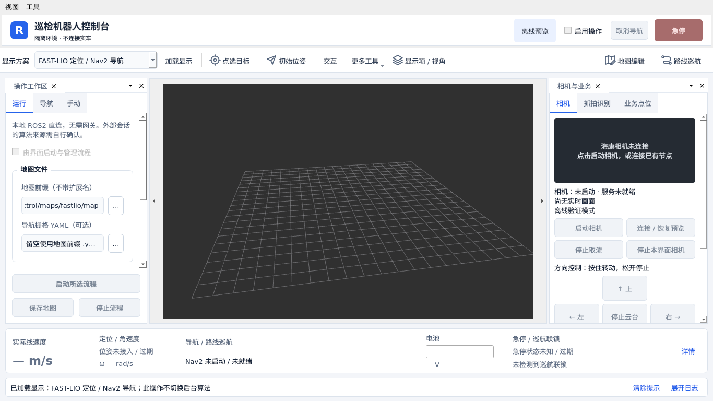
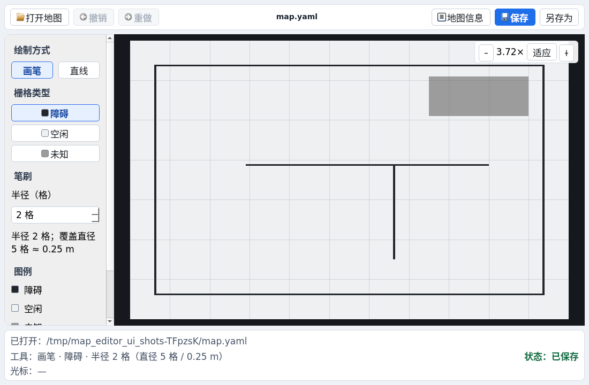
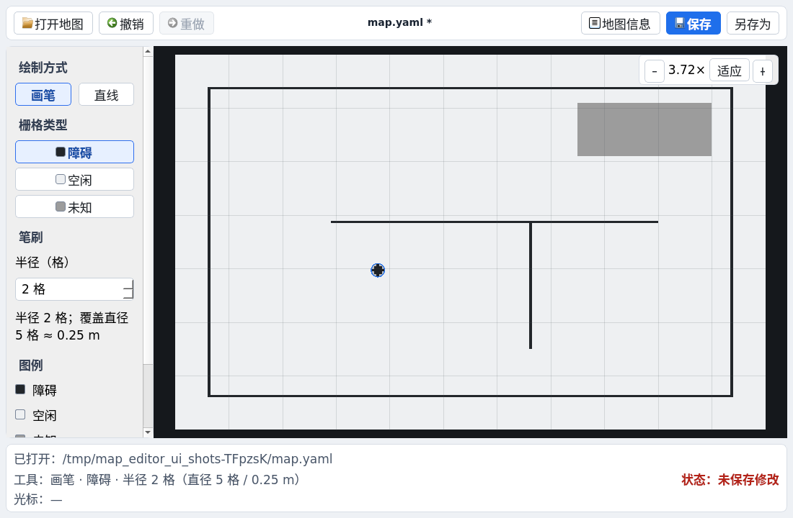
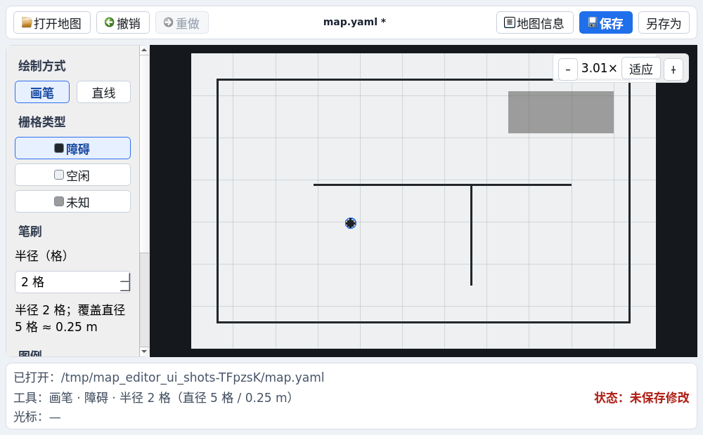

# ROS2 Qt / RViz2 桌面端

从 `/home/jkbot/Ros_Qt5_Gui_App` 移植窗口表单、停靠布局、图标与速度仪表，在独立模块内适配 ROS2 Humble。中央区域嵌入真实 RViz2，地图、激光、点云、TF、路径和代价地图沿用 ROS2 数据。

本模块独立构建与启动，原 Qt 工程、业务后端、网页和默认导航启动入口继续使用。海康接入补充了 `hk_camera` 的云台服务并修正抓拍预览；不运行桌面端时，仍可按原方式使用命令行和独立 RViz。

## 当前已加入的 UI 功能

以下按实际界面区域记录当前功能。标注“已接入”表示桌面端已经实现对应接口，实际使用仍需要相应节点、服务或后端运行；目前已完成构建、模拟测试和海康实机视频/只读接口验证，车辆运动和云台实际转动仍需实车验收。

| 界面区域 / 功能 | 已加入内容 | 接入方式与使用条件 |
| --- | --- | --- |
| 主窗口与停靠面板 | 顶部常驻安全栏、左侧运行/导航/手动页签、中央 RViz、右侧相机/抓拍识别/业务点位页签、底部状态与折叠日志；浅色面板与统一 SVG 图标 | 独立 Qt5 应用；“视图”菜单恢复面板和默认布局，小窗口自动收起右侧 |
| 顶部模式与显示工具 | 六种建图/导航模式选择、重新加载显示、展开 RViz 显示项与视角、点选目标和初始位姿 | 切换显示不自动切换后台算法；支持 FAST-LIO、SLAM Toolbox 建图 / AMCL 定位、Cartographer 的建图与导航配置 |
| 中央地图 / 雷达 / 点云 | 嵌入真实 RViz2，显示地图、扫描、点云、TF、机器人模型、路径和代价地图；保留 RViz 相机操作、选择与测距工具 | 直接读取 ROS2 数据，具体显示项取决于所选配置与实际发布的话题 |
| 本地接口 / 可选业务服务 | 导航和车辆操作直连本地 ROS2；可配置同机业务后端地址 | 不使用 WebSocket 或虚拟组网；业务点位仍复用同机 HTTP 服务 |
| 操作状态与急停 | 默认观察模式、“启用操作”、急停、解除急停、取消导航 | 车辆命令直接使用本地 ROS2 接口；急停可在观察模式下主动点击，解除急停需要有效反馈与导航停止 |
| 目标位姿与单点导航 | 输入 X/Y/朝向、发送导航目标、设置初始位姿；支持 RViz 点选同类操作 | 使用 `map` 坐标系；界面朝向为度，发送时转为弧度；导航要求有效定位、Nav2 就绪及明确解除急停 |
| 手动行驶 | 手动接管、速度/角速度设置、前进、倒车、前进左右转及倒车左右打轮；按住运动、松开停止，窗口失去激活状态时停止本次输入 | 接管时先保持急停并取消导航，再等待反馈；运动请求限幅，反馈失效或停止更新后终止持续下发 |
| 运行状态 / 速度仪表 | 底部数字速度仪表、定位/Nav2/巡航摘要、电池与独立急停/联锁状态；“详情”展开实际位姿 | 线速度统一为 m/s，倒车保留负号；未接入/过期显示“—”；guard 就绪和速度锁定分别表达 |
| 相机监控 | 独立启动/停止相机、连接已有节点、恢复/停止取流、实时视频与分辨率/预览帧率、过期提示、画面保存、云台方向与变倍、设备坐标读取 | 直连本地 `/hk_camera/*`，不依赖导航或网关；按设备能力开放绝对角度，方向控制按住运动、松开停止 |
| 抓拍 / 数字仪表识别 | 相机抓拍预览、业务抓拍、按需识别当前画面、显示识别文本与置信度 | 分别使用海康抓拍服务、本地 `/capture_request` 抓拍链路和 `/ocr/recognize`；专用仪表读数规则仍需识别模块适配 |
| 任务点位 | 刷新已有点位、显示坐标和朝向、保存当前位置为点位、删除所选点位、选点填入目标框 | 复用 `/api/points`；选点后不会自动发车，保存当前位置要求有效的 `map` 位姿 |
| 本地路线与多点巡航 | 主窗口“路线巡航”打开本地页面；登记/设置活跃地图，管理本地点位和有序路线，保存停稳后的实际位姿，执行单次/指定圈数/持续循环，暂停/继续/取消并查询任务记录 | 依赖本机 `patrol_interfaces`、`robot_patrol` 和 Nav2；不依赖 HTTP 后端。需要在启动会话时显式勾选“启用路线巡航联锁”，由同一个 launch 启动 mux 锁、执行器与 guard |
| 路线 / 巡检计划入口 | 右侧“业务点位”页中的“打开旧业务巡检计划”按钮 | 打开原有业务网页；旧业务计划执行接口仍不承担本地巡航 |
| 本机会话管理 | 显式启动所选建图/导航流程、设置地图路径、选择是否启动雷达/IMU、底盘驱动和控制桥、选择里程计源、按需启用路线巡航联锁、停止自身启动的会话 | 默认只连接已有系统；检测重复管线，只管理本应用启动的进程组；底盘与控制桥默认关闭；巡航联锁默认关闭，启用时同时启动 patrol_node/patrol_guard |
| 地图保存 | FAST-LIO PCD 与自动二维切片保存、SLAM Toolbox 序列化与栅格保存、Cartographer 状态快照与栅格保存 | 一次点击保存建图状态和导航 PGM/YAML；FAST-LIO 自动串联 `/map_save`、`pcd2pgm` 和 Nav2 存图工具 |
| 地图编辑 | 独立窗口打开已有 PGM/YAML；顶部文件栏、左侧画笔/直线与三态工具、中央画布、可折叠属性栏和底部状态分区；支持自动适配、缩放/平移、悬停笔刷预览、撤销/重做、快捷键、直接保存和备份另存；保存后按来源校验结果提示并回填“导航栅格 YAML” | 纯本地 Qt + yaml-cpp，不依赖 ROS、网关或后端；直接保存写回当前 YAML 并保留备份，另存用于生成新名字地图 |
| 消息与会话日志 | 底部常驻消息摘要、可折叠的带时间日志；服务/存图错误保留到相关操作成功或手动清除 | 普通状态更新不覆盖失败提示，不把发送请求当成操作完成 |
| 离线验证与截图 | 离线观察模式、六模式自动检查、定时退出、保存整个界面截图、截图成功/失败提示与退出码 | 通过启动参数使用；`xvfb-run` 下在虚拟显示器运行，不弹出桌面窗口 |

桌面端是本地 ROS2 软件，显示、初始定位、导航、手动控制、急停和抓拍均不依赖 `robot_gateway`。相机、OCR、点位和地图保存仍需各自的 ROS2 节点或同机 HTTP 业务服务；界面不会随导航自动启动相机；可在“相机监控”中单独点击启动海康采集。OCR 算法和业务后端仍需独立启动。

## 主界面布局（2026-10-18）

主界面按“地图为中心、操作分组、关键状态常驻”整理，导航、巡航和底盘接口沿用原实现。

| 原位置 / 功能 | 现在的入口 |
| --- | --- |
| 会话启动、地图路径、雷达/底盘/控制桥、巡航联锁、存图和停止流程 | 左侧“运行”；里程计来源在“高级选项” |
| 目标 X/Y/朝向、发送目标、设置初始位姿 | 左侧“导航”；点击顶部目标/初始位姿工具会切到此页 |
| 手动接管、解除急停、速度/角速度、六方向按钮 | 左侧“手动”；离开页面或隐藏面板会结束当前按住的速度输入 |
| 相机视频、连接、方向/变倍、保存当前画面 | 右侧“相机”；绝对位置、设备范围和读写入口在“云台位置与设备参数” |
| 抓拍预览、业务抓拍、OCR | 右侧“抓拍识别”；抓拍图随可用区域保持宽高比 |
| 旧 HTTP 点位表、业务地址、旧网页计划入口 | 右侧“业务点位”；本地巡航点位继续在独立“路线巡航”窗口管理 |
| 速度仪表、定位、导航、巡航、急停、电池 | 底部状态概览；“详情”查看完整位姿 |
| 原 RViz 英文工具栏 | 顶部中文工具；移动视角、选择、聚焦和测距在“更多工具”，属性树在“显示项 / 视角” |
| 日志与关闭的面板 | 底部“展开日志”；“视图”菜单可恢复工作区及默认布局 |
| 地图编辑 / 路线巡航独立窗口 | 顶部入口，窄屏也可从“工具”菜单打开 |

默认窗口按屏幕可用区域设置尺寸；宽度小于 1180 个逻辑像素时收起右侧，可从“视图 → 相机与业务”重新打开。正常运行仅记忆窗口几何、Dock 布局和页签，配置位于 Qt 用户配置目录的 `RemoteCtrol/desktop_console_v1.ini`。恢复布局不恢复操作许可、手动输入、急停解除、巡航继续或流程自动启动。离线模式不读取或覆盖日常布局配置。

运行页的启动/存图/停止固定在页签底部，参数区独立滚动。窗口低于 650 个逻辑像素时，三个按钮改为单行“启动 / 存图 / 停止”，角速度与电压的次要读数收起以保留地图空间；点击“详情”或放大窗口可重新查看完整读数。

相机页切换、收起和失焦会结束当前云台/变倍 jog；普通切页不关闭取流或相机进程。顶部“启用操作”、取消和急停始终位于工作区之外；观察模式下仍可明确点击急停，离线预览保持禁用。

开发范围与验收清单见[主界面 UI 美化开发计划](../主界面UI美化开发计划.md)。

当前主界面实际截图（1366×768，离线预览；无实车数据）：



其他截图：[1920×1080](docs/main_window_1920.png)、[紧凑窗口](docs/main_window_compact.png)、[手动页](docs/main_window_manual.png)、[抓拍识别页](docs/main_window_capture.png)、[150% 缩放](docs/main_window_highdpi.png)。隔离测试另有[模拟导航渲染](docs/main_window_navigation_simulated.png)、[模拟暂停任务](docs/main_window_patrol_simulated.png)、[模拟联锁锁定](docs/main_window_interlock_simulated.png)，后面三张只说明 UI 展示与接口行为，不代表实车状态。

## 代码模块划分

| 模块 | 主要文件 | 职责 |
| --- | --- | --- |
| 主窗口与交互 | [mainwindow.cpp](src/ui/mainwindow.cpp)、[mainwindow_layout.cpp](src/ui/mainwindow_layout.cpp)、[console_theme.cpp](src/ui/console_theme.cpp) | 分离操作协调、布局/状态投影及局部主题，用户操作继续交给已有适配器和运行管理模块 |
| 相机监控模块 | [camera_panel.cpp](src/ui/camera_panel.cpp) | 独立相机进程、预览、画面保存、连接状态、设备能力和云台按住控制；与导航进程管理分开 |
| 速度仪表 | [mainwindow_layout.cpp](src/ui/mainwindow_layout.cpp)、[旧表盘源码](src/ui/widgets/dashboard.cpp) | 主窗口使用紧凑的真实速度数字仪表，旧表盘源码保留，未在主界面占位 |
| RViz2 容器 | [rviz_host.cpp](src/rviz/rviz_host.cpp)、[config/rviz](config/rviz/) | 嵌入 RViz、加载独立显示配置、选择工具、显示或隐藏原生属性面板 |
| ROS2 数据与服务适配 | [ros_adapter.cpp](src/adapters/ros_adapter.cpp) | 订阅 TF、里程计、急停、Nav2 状态、相机和电池；直接调用 Nav2 Action，发布初始位姿/手动速度/急停/业务抓拍，处理服务和超时 |
| 本地车辆操作 | [local_controller.cpp](src/adapters/local_controller.cpp) | 操作使能、接管与取消等待、明确解除急停、按住行驶、限幅、松键停车及反馈超时 |
| 业务后端适配 | [business_client.cpp](src/adapters/business_client.cpp) | 通过 HTTP 读取、新增和删除现有后端点位，不直接访问 SQLite |
| 本地进程管理 | [process_manager.cpp](src/runtime/process_manager.cpp) | 组合原 ROS2 启动入口及参数，加载环境，管理自身子进程与进程组，转发启动日志 |
| 地图保存流程 | [map_saver.cpp](src/runtime/map_saver.cpp) | 按建图后端组织状态保存与栅格导出，管理超时、保存中状态和产物检查 |
| 本地地图编辑器 | [src/map_editor](src/map_editor/)、[map_editor_dialog.cpp](src/ui/map_editor_dialog.cpp)、[map_canvas.cpp](src/ui/widgets/map_canvas.cpp) | 独立的 PGM/YAML 文档模型、三态笔刷与直线编辑、撤销/重做、坐标换算、备份及版本化另存；不链接 ROS 或业务后端 |
| FAST-LIO 栅格导出 | [export_fastlio_map.py](scripts/export_fastlio_map.py)、[切片参数](config/fastlio_map_export.yaml) | 独立进程完成 PCD 高度过滤、二维投影与 Nav2 PGM/YAML 保存；独立话题避免串图，失败保留旧栅格 |
| 配置与模式定义 | [config.cpp](src/runtime/config.cpp)、[desktop.json](config/desktop.json) | 管理连接地址、话题、限幅、超时、六种模式及其坐标系和启动入口 |
| 程序入口与离线运行 | [main.cpp](src/main.cpp) | Qt/ROS2 初始化与退出、命令行参数、隔离模式、自动检查、定时退出和截图结果输出 |
| 迁移资源与第三方控件 | [resources](resources/)、[third_party/dockWidget](third_party/dockWidget/)、[NOTICE.md](NOTICE.md) | 保存迁移的图标、媒体与停靠控件，保留来源及许可说明 |
| 构建、启动与测试 | [scripts](scripts/)、[tests](tests/) | 独立依赖安装、构建、启动；控制协议、ROS2 模拟服务及 GUI 集成测试 |

界面层不实现定位、路径规划或底盘运动学。ROS2 数据读取、车辆命令、业务 HTTP、进程管理和存图流程分别封装，后续增加功能可在对应模块扩展。

## 尚未实现的相关能力

基础二维栅格地图编辑已实现；完整路线/禁行区图层、实时热切换及后续扩展范围见 [地图编辑开发计划](../地图编辑开发计划.md)。

- 旧业务网页计划与本地巡航执行器的正式对接、定时无人值守调度，以及到点后自动串联云台、抓拍、OCR 与报告。
- Qt 内的指定路径编辑与执行、完整路线/计划编辑器、独立禁行区图层和运行中热切换地图。
- 智能掉头、精准停靠及新的阿克曼控制或 Nav2 行为插件；本次移植没有改变车辆运动算法或精度。
- 网页与 Qt 之间由服务端强制执行的控制权互斥。

当前已经完成的显示和接口接入，与上述待开发能力分开记录；实车功能和性能仍以实际联调结果为准。

## 独立视觉执勤（2026-10-18）

右侧 **“抓拍识别 → 独立视觉执勤”** 提供两组独立按钮：“启动/停止人脸抓拍”“启动行人/车牌、停止上位机检测”，并可分别勾选行人、车牌。无需启动导航、巡航或解除急停，也无需启用车辆运动操作，支持静止执勤。首次启动复用或启动原相机节点；不启动底盘、雷达、网关、业务后端或云台运动。

海康负责检测人脸并提供小图，软件不进行身份比对或读取人脸库；同一个人的不同抓拍全部留档。上位机直接使用已有 OpenVINO YOLO 导出模型和 HyperLPR3，单个 YOLO 实例处理行人与车辆，移除了上位机的人脸模型。两类上位机功能都关闭时停止推理。

“查看视觉记录”打开独立历史窗口，支持类别筛选、分页、小图和坐标详情。记录保存在 `data/vision/`，业务后端未启动仍可记录和查询。切换主界面导航模式、切页或隐藏面板不停止执勤。没有有效定位或尚未关联地图标记时，照常保存图片，坐标显示无效；需要坐标时在记录窗口关联实际地图标记，软件只读取已有定位 TF，不启动导航。

海康的时间是主机接收抓拍报警的时间，因此记录位置是对应时刻的近似，不能当作精确曝光位置。现有手动抓拍和数字仪表 OCR 入口保留。`--offline` 下禁用真实视觉启停。

依赖安装、独立命令、数据格式、可选后台同步与测试见 [vision_events README](../ros2_ws/src/vision_events/README.md)，本轮交付与验证见 [视觉执勤实现与验证记录](视觉执勤实现与验证记录.md)。新增 `desktop_vision` 隔离测试覆盖无导航/无车辆运动许可时的启停、切页继续、历史查询与离线禁用；真实抓拍、车牌准确率和移动位置误差待现场验收。

## 构建和启动

在项目目录执行：

```bash
./desktop_ui/scripts/build.sh
./desktop_ui/scripts/run.sh
```

构建结果为 `desktop_ui/build/robot_desktop`。脚本自动加载 Humble 与现有工作空间 overlay，默认使用 2 个编译任务，可设置 `DESKTOP_BUILD_JOBS`。输出目录可通过 `DESKTOP_BUILD_DIR` 指定，不复用原 ROS2 工作空间的构建目录。

桌面依赖安装脚本为 `scripts/install_dependencies.sh`，需要的主要开发包为 `qtbase5-private-dev`、`libqt5svg5-dev`、`libyaml-cpp-dev`。ROS2 / RViz2 沿用现有环境。相机、OCR、电池和本地巡航集成在构建时自动检测 `hk_camera`、`ocr_interfaces`、`yunle_msgs`、`patrol_interfaces`；缺少巡航接口时主窗口显示不可用并保留原有功能。

当前终端没有图形桌面时可离线预览：

```bash
LIBGL_ALWAYS_SOFTWARE=1 xvfb-run -a -s '-screen 0 1600x1100x24 +extension GLX +render -noreset' \
  ./desktop_ui/scripts/run.sh --smoke-test --screenshot /tmp/robot_desktop.png
```

`--smoke-test` 使用隔离 ROS 域 218，禁用控制、业务写入和进程启动，依次加载六种模式后自动退出；`--offline` 保持离线界面不自动退出。正常启动不带这两个参数。

`xvfb-run` 使用虚拟显示器，不会在桌面弹出窗口。截图目录必须存在且可写；成功后终端打印保存路径，失败时打印错误并返回退出码 2。项目内的日志目录应写成 `./hk_log/` 或其绝对路径，`/hk_log/` 则是根目录下另一个目录。

## 连接已有系统

可先按原方式启动底盘、传感器及定位/导航，然后启动 Qt 连接已有 ROS2 系统；也可用界面启动并管理所选流程。无需启动网关；只有业务点位管理需要可选的同机业务后端。启用嵌入 RViz 时，将原导航入口的 `rviz` 参数设为 `false`，减少重复显示负载。

默认配置在 [config/desktop.json](config/desktop.json)：

- 业务后端：`http://127.0.0.1:8888`。
- 速度反馈：`/odom`；海康视频：`/hk_camera/image_raw`。
- 电池：`/battery_status`，消息为 `yunle_msgs/msg/Battery`，容量为百分比。
- 手动速度上限：0.3 m/s，角速度上限：0.5 rad/s，仍经过原有 `twist_mux` 和底盘控制链。

配置可复制到自己的目录，通过 `--config /绝对路径/desktop.json` 使用；项目路径可通过 `ROBOT_PROJECT_ROOT` 或 `--project-root` 指定。窗口中的连接地址修改只影响本次会话，不覆盖现有项目配置。

界面默认观察模式，不发送速度、导航目标、初始位姿或急停解除指令。勾选“启用操作”才允许写接口。首次运动前需明确点击“解除急停（保持静止）”；如果 Nav2 状态尚未知，界面先请求取消所有目标并确认状态。相机、OCR、点位与存图仍需对应节点或业务服务。

桌面端与机器人同机运行是当前主要支持方式。异机显示还需要配置可用的 ROS2 DDS 网络、相同消息包和 TF；RViz 数据直接来自 ROS2 DDS。地图文件保存及路径检查目前按同机语义工作。

## 显示模式和导航

界面提供六种显示/启动配置：FAST-LIO 建图、FAST-LIO 定位导航、SLAM Toolbox 建图、AMCL 定位导航、Cartographer 建图与定位导航。

**切换下拉模式只加载显示配置，不切换正在运行的后台算法。** 建图和定位导航入口不同，各后端运行时三选一；二维建图默认不启动 Nav2。

“运行 → 高级选项 → 里程计来源”按所选模式自动显示。固定来源的模式禁用下拉框，并给出中文说明：

| 所选模式 | 显示的里程计来源 | 是否可修改 |
|---|---|---|
| FAST-LIO 三维建图 | `lio`（雷达 + IMU） | 固定 |
| FAST-LIO 定位 / Nav2 导航 | `lio`、`wheel` 或 `wheel_imu` | 启动前可选；运行或保存中锁定 |
| SLAM Toolbox 建图 / AMCL 定位导航 | `wheel_imu`（底盘 + IMU 融合） | 固定 |
| Cartographer 建图 / 定位导航 | `wheel_imu`（底盘 + IMU 融合） | 固定 |

FAST-LIO 导航初始仍为 `lio`；本次打开界面后手动选过的来源，在切换其他模式再回来时会保留，固定模式不会覆盖该选择。选择 `wheel` 或 `wheel_imu` 不会关闭 FAST-LIO + ICP 地图定位。该选项只控制由界面启动的新流程，连接已有系统时不会修改后台里程计。

- FAST-LIO 建图使用 `lio_odom`。
- 定位导航及二维建图使用 `map`。
- RViz 工具先发布到 `/desktop_ui/goal_request` 和 `/desktop_ui/initial_pose_request`，由桌面端检查操作使能、模式和车辆状态；随后分别调用本地 `/navigate_to_pose` Action 和发布 `/initialpose`。
- 点选目标和输入坐标发送目标时，红色箭头通过专用 `/desktop_ui/selected_goal` 显示，点选结果同步到左侧坐标框。观察模式下也可点选预览，箭头表示所选位置；是否执行导航以 Nav2 状态和请求结果为准。该显示话题不触发导航。
- 也可在左侧输入 X/Y/朝向，界面朝向为度，ROS2 位姿使用四元数。FAST-LIO 初始定位不要求已有 `map → base_link` TF，也不要求解除急停。
- 初始位姿下发不代表定位成功；车辆位姿以有效、未过期的 TF 为准。AMCL 通过同一标准话题初始化/重新定位，启动后等待用户给出实际位置与朝向；发送前检查定位节点是否订阅；当前 Cartographer 纯定位入口不支持 `/initialpose`，应在建图起点启动。
- 路径、点云等显示项取决于实际发布的话题；未发布的话题可以在 RViz Displays 面板关闭。
- 默认突出地图画面，点击“显示项 / 视角”展开 RViz 原生属性与视角面板。

桌面端只使用自己的 `.rviz` 配置副本，不覆盖原配置。嵌入接口基于 [RViz2 Humble VisualizationFrame](https://github.com/ros2/rviz/blob/humble/rviz_common/include/rviz_common/visualization_frame.hpp)。

## AMCL 本地启动顺序

1. 选择“AMCL 定位 / Nav2 导航”。该项沿用原 `slam_navigation` 配置 ID 和 `maps/slam_toolbox/map` 地图前缀，SLAM Toolbox 建图入口保留。
2. 地图需有 `.yaml` 和其引用的 `.pgm/.png`，定位不再要求 `.posegraph/.data`。已有栅格地图可直接使用。
3. 勾选由界面管理流程，按实际需要选择雷达/IMU、底盘和控制桥，点击启动。后台使用 `amcl_localization.launch.py`。
4. 勾选“启用操作”，用“点选初始位姿”标出实际位置和朝向；此操作允许在 `map→base_link` 尚未建立时进行。
5. 等待 AMCL 收到有效扫描并建立地图 TF、位姿显示有效、Nav2 完成激活；随后明确解除急停，再发送目标。

AMCL 独立显示配置包含 `/amcl_pose` 位姿及 `/particle_cloud` 粒子云，视角固定 `map`，定位前即可观察栅格地图。初始定位前出现等待 `map` TF 的日志属于等待初始化。车辆停止且导航取消后可以重新给初始位姿；当前基准参数需继续现场验证。此定位模式只运行 AMCL，轮速+IMU EKF 提供里程计；FAST-LIO 与 Cartographer 的入口独立。三种导航的 20 cm 终点位置容差保留。

旧命令 `slam_2d_localization.launch.py` 兼容转入 AMCL。参数文件、命令行用法和隔离运行测试见项目根目录的 [2D 建图导航](../2d建图导航.md)。

## FAST-LIO 本地启动顺序

1. 选择“FAST-LIO 定位 / Nav2 导航”，地图前缀填写 `/home/jkbot/Remote_ctrol/maps/fastlio/map`。
2. 勾选“由界面启动与管理所选流程”，按实际需要启用雷达/IMU、底盘驱动与控制桥，里程计选择 `wheel_imu`；已有管线则直接连接观察，不重复启动。
3. 启动后勾选“启用操作”，用“点选初始位姿”标出车辆实际位置和朝向。初始定位前 Nav2 等待 `map` TF 属于等待初始化。
4. 等待日志出现 `Initial global localization succeeded.`、车辆位置有效及 Nav2 激活完成，再点击“解除急停”，然后点选目标。

FAST-LIO 导航使用专门的 `navigation_fastlio.rviz`，默认显示全局 PCD 与当前点云，视角固定在 `map`，不会等待车体定位后才能观察地图。建图使用 `lio_odom`、20 米默认视距、固定 3 像素点及 `/cloud_registered` 累积显示；算法默认不发布的 `/Laser_map`、`/cloud_effected` 和 `/path` 显示项默认关闭。显示配置只影响 RViz，不改变建图输出。

## 遥控与急停

遥控沿用现有链路：

```text
Qt → 本地 ROS2 /cmd_vel_teleop → twist_mux → 原底盘控制链
```

手动操作顺序：

1. 勾选“启用操作”。
2. 点击“手动接管”：直接发布急停并请求 Nav2 取消所有目标，界面等待 ROS 急停反馈及导航结束。
3. 点击“解除急停（保持静止）”。
4. 按住前进、倒车或转弯按钮，松开停止；窗口失去激活状态也停止本次手动输入。

不提供原地旋转指令。倒车转弯按钮标注“左打轮/右打轮”，按反向行驶时相应的角速度符号下发。界面显示的 `ω` 是 rad/s 角速度，不冒充实际转角。

按住方向键时以 20 Hz 发布手动速度，松开只发送一次零速度；零速度不会解除急停。反馈过期时停止手动输入并发布急停；进程卡住或退出时，原底盘桥的命令超时仍生效。空闲观察时不持续发布零速度。明确操作急停或解除后，ROS 适配线程维持该急停状态反馈。

急停按钮可在观察模式下明确点击使用。本地 UI 和远程网关不能同时控制：发现 `/cmd_vel_teleop` 存在其他发布者时，拒绝本地运动及解除急停，并提示先关闭远程网关或其他手动端。已有自动导航不会因界面进入观察模式或关闭而自动取消；需要停止时使用取消或急停。

## 本地启动会话与地图保存

默认不启动任何机器人进程。需要由界面启动时，勾选“由界面启动与管理所选流程”，设置不带扩展名的地图绝对路径，并按实际需要选择雷达/IMU、底盘驱动和控制桥。底盘与控制桥默认关闭；FAST-LIO 建图固定使用 LIO 里程计，导航可选择原入口支持的里程计源。只有需要本地多点路线巡航时，才勾选“启用路线巡航联锁”；该选项会使用带 `/patrol/stop_lock` 的 mux 配置，并在同一个 launch 中启动 `patrol_node` 与 `patrol_guard`。巡航联锁会话只允许巡航执行器发起的 Nav2 目标，界面会禁用单点导航按钮；手动驾驶仍可用。普通单点导航和手动驾驶默认不依赖巡航服务。连接外部已启动的后端时，界面会根据 `/patrol/stop_lock` 和 `/patrol/executor_heartbeat` 的实际消息自动识别巡航联锁模式，同样禁用单点 Nav2 目标。如果已从命令行单独启动 `robot_patrol`/`patrol_guard`，界面启动会话会检测这些节点及 `/patrol/stop_lock`、`/patrol/executor_heartbeat` 发布者并拒绝重复启动；此时应使用连接模式或先停止旧巡航服务。

启动前检测已有机器人管线；存在时拒绝重复启动，使用连接模式，或从原启动入口结束旧会话。界面仅管理自身启动的进程组，停止不会读取旧 ROS1 的 PID 文件或全局杀进程。关闭前需先结束本界面启动的会话；地图保存期间不能停止会话。

保存功能按后端分别处理：

| 建图后端 | 保存流程 |
| --- | --- |
| FAST-LIO | 调用 `/map_save` 保存 PCD → 等待成功并检查文件 → 运行 `pcd2pgm` 生成二维栅格 → `map_saver_cli` 保存同前缀 `.pgm/.yaml` |
| SLAM Toolbox | `/slam_toolbox/serialize_map` 保存 `.posegraph/.data`，然后 `map_saver_cli` 保存 `/map` 的 YAML/PGM |
| Cartographer | `/write_state` 保存包含未完成子图的 `.pbstream` 快照，然后保存 `/map` 的 YAML/PGM；不自动结束轨迹 |

保存按钮不会结束建图进程。FAST-LIO 服务不接受新文件路径：连接已有建图时，路径必须与那个节点的实际输出配置一致。保存失败时查看界面日志和原节点日志，不能把“已发送请求”当成保存完成。

FAST-LIO 的 PCD 先写入同目录临时文件，成功后再替换目标文件，避免退出或写入失败把旧地图清空。一次显式 `/map_save` 成功后，退出建图会保留这份快照及其配套栅格；若继续建图并希望更新地图，请再次点击保存。没有显式保存时，退出仍保留原有的 PCD 自动保存行为。定位导航启动前会拒绝不存在或零字节的 PCD。

FAST-LIO 建图模式点击“保存当前建图产物”后，默认得到 `maps/fastlio/map.pcd`、`map.pgm` 和 `map.yaml`。PGM/YAML 来自本次保存的 PCD，不订阅机器人正在使用的 `/map` 或其他工具的 `/projected_map`；每次导出都创建独立命名空间和话题，完成或失败后清理本次导出进程。先在同目录的临时目录生成并检查栅格，再替换目标文件；切片失败时保留新 PCD 和原有 PGM/YAML，并在日志说明失败。

参数位于 [config/fastlio_map_export.yaml](config/fastlio_map_export.yaml)：默认高度 `-0.10～2.0 m`、分辨率 `0.05 m`、半径过滤 `0.2 m / 6 邻点`、导出超时 `180 s`，修改后下次保存生效。高度按 PCD 坐标系解释，与现有手动切片命令一致；不额外平移/旋转，也不自动调用 `clean_map.py` 修改像素。保存 YAML 时使用投影消息的完整原点及分辨率，避免当前 Nav2 存图工具截短原点小数导致偏移。切片复用已构建的 `pcd2pgm` 和 `nav2_map_server`，需要 ROS2 Python 的 `rclpy/nav_msgs/ament_index_python` 及 `python3-yaml`。保存过程在后台执行，界面日志依次报告 PCD、切片和栅格保存结果。

## 本地地图编辑

主窗口工具栏“地图编辑”打开独立窗口，默认尝试加载当前地图前缀对应的 YAML，也可通过“打开地图”选择其他 `.yaml`。选择 `.pgm` 时只有在同目录存在同名 `.yaml/.yml` 时才会打开，不会猜测原点或分辨率。

界面按五区域组织：

- 顶部文件栏：打开地图、撤销、重做、当前文件名/未保存标记、地图信息开关、蓝色“保存”和“另存为”。
- 左侧工具区：画笔/直线互斥切换，障碍/空闲/未知三态互斥选择，笔刷半径、覆盖直径和米数。
- 中央画布：拖拽平移、滚轮缩放，右上角有缩小、适应窗口、放大和倍率读数；首次打开和调整窗口时自动适配，手动缩放/平移后不会被状态刷新重置。
- 右侧属性栏：可折叠，显示尺寸、分辨率、完整来源/导出路径（省略显示、悬停查看、复制完整路径）、技术参数和导航选择状态。
- 底部状态区：工具摘要、世界坐标、文件状态和独立操作消息分两行显示；坐标保留两位小数，长摘要在窄窗口省略并保留完整 tooltip，光标移动不会覆盖保存/打开错误。

操作行为：

- 六种绘图组合由“画笔/直线 × 障碍/空闲/未知”两个按钮组产生；笔刷半径 0 表示单格，半径 2、分辨率 0.05 m 时显示覆盖直径 5 格 ≈ 0.25 m。
- 悬停显示当前栅格和笔刷范围预览；预览只画在视图层，不写 PGM、不产生历史、不改变 dirty。
- 一次按下到松开算一步撤销；直线松开后才提交，拖动期间显示状态色预览，Esc 优先取消预览。保存前窗口标题、文件状态和关闭提示都会显示未保存修改。
- 快捷键：`Ctrl+S` 保存，`Ctrl+Z` 撤销，`Ctrl+Y` / `Ctrl+Shift+Z` 重做，`Ctrl+Shift+S` 另存为，`F` 适应窗口；仅在编辑器范围生效。
- “保存”直接写回当前编辑 YAML，文件名不变，适合直接修改 `maps/<backend>/map.yaml` 后继续用原地图前缀启动导航。保存前会备份旧 YAML 和当前引用图片；新 PGM 使用带时间戳的文件名，YAML 原子替换，避免图片/YAML 半写。
- “另存为”默认生成 `<原名>_edited.yaml`，用于保留原文件名并生成新地图；图片同样使用带时间戳的新文件名。若目标已存在，会先备份旧 YAML 和它引用的图片，再用 `QSaveFile` 提交新 YAML。
- 保存后，主窗口按初始后端、地图前缀和实际来源 YAML 校验是否回填“导航栅格 YAML”。右侧属性栏会区分“已选为下次导航地图”“已保存未自动选用”和“当前选择指向其他 YAML”；手动改地图前缀或切模式后，已有选择会改为“来源模式或地图前缀已变化，待确认”。拒绝新结果时保留原选择。
- 该字段留空时三套导航仍使用原地图前缀的 `.yaml`。FAST-LIO 的 `pcd_map` 和 Cartographer 的 `map_file` 不会被编辑图替换，编辑图只在下次导航启动时作为 `map:=...` 使用。
- 当前假设已知：205 像素不一定等于未知。已有三套地图的 `free_thresh=0.25` 下，真实 Nav2 Map Server 会把 205 解析为空闲；编辑器按当前 YAML 的 `negate` 和阈值推导三态编码，不会写死 205。

合成地图离线预览（正常、未保存修改、紧凑窗口）：







截图使用合成地图生成，不包含实测地图。需要重新生成演示地图时执行：

```bash
python3 desktop_ui/scripts/make_map_editor_demo_map.py /tmp/map_editor_demo
# 然后在主窗口“地图编辑”中打开 /tmp/map_editor_demo/map.yaml
```

## 本地路线与多点巡航（第一版）

主窗口工具栏“路线巡航”打开同一应用内的独立路线页面。页面通过本机 ROS2 服务/action 工作，不经过 HTTP 后端或网关：

- 地图绑定：页面预填当前模式的地图 YAML；点击“登记当前地图”，再选择已登记地图“设为活跃地图”。执行器会复核 YAML、PGM、定位文件摘要及栅格几何，地图文件变化时拒绝直接执行。
- 点位：可读取 `robot_patrol` 采集的停稳实际位姿保存为导航点，也可手动编辑 x/y/yaw；点位按地图隔离。
- 路线：把点位按顺序加入路线，设置每点停留秒数，支持上移、下移、移除、保存和删除。路线执行前必须使用已保存版本。
- 执行：支持单次、指定圈数和持续循环（0 表示持续），逐点调用 Nav2 `NavigateToPose`，到点后等待停稳和 dwell，再派发下一点；提供暂停、继续、取消和当前状态/圈数/步骤显示。
- 执行前置检查：UI 开始按钮与主窗口“启用操作”、定位导航模式、有效 `map` 位姿、Nav2 就绪及新鲜急停反馈联动；服务端还要求 `/emergency_stop=false` 新鲜、`/patrol/guard_ready=true` 新鲜、`/map` 元数据与活跃地图几何一致，活动任务期间禁止切换活跃地图。
- 地图/点位版本：同路径地图几何变化时旧点位和路线会自动失效清除；点位修改会提升所有引用该点位的路线 revision，旧路线预览不能绕过版本检查。
- 点位采点：要求里程计新鲜、车辆停稳、`map→base_link` TF 在有效期内；采样时间取 TF 时间。暂停在 dwell 中恢复时会重新确认车辆仍在当前点，否则重新导航当前点。
- 记录：查询任务终态、完成圈数/步骤和错误信息。数据默认写入 `~/.local/share/robot_patrol/patrol.sqlite3`。
- 离线模式仍可打开页面编辑数据，但开始/暂停/继续/取消执行按钮禁用。

**当前边界：**独立 `patrol_guard`、执行器/操作端心跳、`twist_mux` 死锁联动和主窗口急停/手动接管/取消导航与巡航任务的协调已接入。导航会话默认使用普通 mux；只有勾选“启用路线巡航联锁”时才传入 `enable_patrol:=true`，并由底盘 launch 同时启动 patrol_node/patrol_guard。guard 校验 `/diagnostics` 中的 patrol mux 锁，并在复位前直接向 Nav2 发送 cancel-all、核对 action status，新执行器 IDLE 不能代替旧目标终止证明。手动接管和解除急停都要求新鲜里程计并连续停稳；关闭窗口会等待巡航取消和停车确认。仍缺少 RViz MarkerArray 路线预览与地图取点、JSON 导入导出和 CLAIM 租约；本轮只做隔离 ROS 验证，**不能把当前版本当作已完成实车验收的版本**，实车 P6 仍需现场验收。

新增 ROS2 包需要先构建：

```bash
cd ros2_ws
source /opt/ros/humble/setup.bash
colcon build --packages-select patrol_interfaces robot_patrol --symlink-install
source install/setup.bash
ros2 launch robot_patrol patrol.launch.py
```

隔离测试可使用独立 `ROS_DOMAIN_ID`；数据服务和执行器可以分开启动。CLI 入口为 `ros2 run robot_patrol patrol_cli`。

## 视频、云台、OCR 与点位

“相机监控”独立于六种导航/建图模式，无需网关、业务后端或雷达即可使用：

1. 打开界面，在右侧“相机监控”点击“启动相机”。程序读取现有海康参数文件，自动登录、取流。已有节点时直接显示视频，用“连接 / 恢复预览”执行登录与恢复取流。
2. 状态区显示相机由本界面管理还是外部启动、服务是否就绪、分辨率和界面预览帧率。超过 3 秒无新图像时清除旧画面并提示过期；预览采用最新帧缓存，最高约 10 fps。
3. “保存当前画面”将当前帧另存 PNG/JPG，默认目录 `~/Pictures/robot_camera/`。下方“相机抓拍（预览）”调用 SDK 原图抓拍服务，空路径使用临时 JPEG 并在返回后删除，不再写入旧机器的 `/home/nvidia` 路径。
4. 点击“读取当前云台”，读取设备上报坐标和光学变倍范围。当前相机 `iDS-2ZMN2307S(E)` 返回 **1～23 倍**，水平、俯仰范围均为 0，未提供可靠的绝对角度能力；界面禁用这两个角度输入，仅设置光学变倍。支持绝对角度的其他机型按其返回范围开放。
5. 勾选顶部“启用操作”后，可按住上/下/左/右或放大/缩小；松开、窗口失活、取消使能、视频过期或关闭面板对象时发送停止。驱动收到方向请求后维持 500 ms 租约，界面每 150 ms 续期，超时停止，SDK 停止失败时重试。固定方向速度为 SDK 3 档。
6. “停止取流”停止该节点的视频采集；“停止本界面相机”仅关闭本界面创建的相机进程。退出界面会回收自身相机进程，外部相机节点保持运行。切换/停止导航不会停止相机。

配置 `camera_params_file` 指向 `hk_camera_params.yaml`，相对路径以项目根目录解析。默认复用工作空间安装目录的相机参数文件；账号、密码继续只在原驱动配置中管理，不复制到桌面配置或启动命令。界面启动仅监控视频，覆盖 `enable_face_capture:=false`，不启动人脸抓拍。

服务接口：`/hk_camera/login`、`/hk_camera/start_stream`、`/hk_camera/stop_stream` 使用 Trigger；`/hk_camera/get_ptz_pose` 使用 `GetPTZPose`；`/hk_camera/control_ptz` 使用 `ControlPTZ`；`/hk_camera/set_ptz_pose` 使用 `SetPTZPose`。这些服务均位于 `/hk_camera/` 命名空间。绝对云台服务已改正为 SDK 的角度/变倍语义，不再把水平角误用为预置点编号；既有独立 Qt 相机程序的预置点接口保留。

首次构建新海康服务后再构建界面：

```bash
cd /home/jkbot/Remote_ctrol/ros2_ws
source /opt/ros/humble/setup.bash
source install/setup.bash
CMAKE_BUILD_PARALLEL_LEVEL=2 colcon build --packages-select hk_camera --symlink-install
cd ..
./desktop_ui/scripts/build.sh
./desktop_ui/scripts/run.sh
```

- 云台坐标按海康 SDK 的十进制压缩编码和 0.1°/0.1 倍单位处理，参见 [NET_DVR_PTZPOS 官方结构说明](https://open.hikvision.com/hardware/structures/NET_DVR_PTZPOS.html)。设置请求成功表示设备接受，实际到位需读取反馈；本设备的外部 RS485 云台方向控制不提供可靠角度反馈。
- “业务抓拍”直接发布 `/capture_request`，订阅 `/capture_done` 查看结果，与相机预览抓拍分开。
- 仪表识别调用 `/ocr/recognize`；当前节点使用 EasyOCR，默认按需识别。输出包括文本和置信度，具体仪表的区域、读数筛选规则继续由识别模块适配。
- 点位列表读取现有 `/api/points`，支持刷新、保存当前 map 位姿、删除所选点位；选择点位填入目标框，不自动发车。
- 旧路线/计划管理按钮仍打开原有业务页面；本地点位、路线和多点巡航使用新的“路线巡航”页面，两者数据暂不自动互通。当前业务点位缺少地图 ID，请确认选用的是当前地图的点位。

旧任务表按距离轮询、无限循环发目标的执行代码未迁入。新的本地执行器已支持单次/有限/持续逐点循环，但尚未接入定时无人值守、到点云台/抓拍/OCR联动或业务报告；旧网页计划执行接口仍不直接调用新执行器。

## 验证与代码边界

`scripts/build.sh` 构建后运行测试；也可手动运行，但必须先加载 ROS2 与项目 overlay，否则测试找不到 `hk_camera` 等动态类型库：

```bash
source /opt/ros/humble/setup.bash
source ros2_ws/install/setup.bash
ctest --test-dir desktop_ui/build --output-on-failure
```

测试使用隔离 ROS 域中的模拟 Nav2 Action、话题和服务。GUI 测试在 Xvfb 中验证地图/点云接收及彩色像素、无定位 TF 时的真实 RViz 点选、本地目标下发和取消、接管与松键停车；不启动实车底盘、导航执行器或相机。没有实车运动精度验收。新增 `desktop_map_saver` 测试模拟 `/map_save`，实际调用 PCD 切片及 Nav2 栅格工具，覆盖自动三文件保存、带空格/中文/引号的路径、原点精度、隔离其他地图、过滤失败/超时保留旧图、失败后重试和导出进程退出。
新增地图编辑测试：`desktop_map_editor` 覆盖 P5 解析、阈值语义、坐标换算、撤销/重做、直接保存、备份与另存；`desktop_map_editor_ui` 在 offscreen 环境用真实鼠标事件验证五区域控件、自动适配与手动视图、六种工具组合、半径/直径显示、悬停坐标、状态分区、快捷键、三态笔刷、撤销/重做、Esc 未保存提示、直接保存和另存；`desktop_ui_integration` 验证同源回填及导航选择状态反馈；`desktop_map_editor_nav2` 调用 Humble 的真实 `nav2_map_server::loadMapFromYaml`，确认未知/空闲/障碍分别输出 -1/0/100，并确认现有 205 灰度在 `free_thresh=0.25` 下真实解析为空闲；`desktop_ui_lifecycle` 覆盖编辑器仍打开时直接析构主窗口的退出顺序；`desktop_patrol_page` 验证路线巡航页面在无服务时安全降级并正确禁用地图/执行操作。巡航执行器、guard 和 mux 的独立测试由对应 ROS 包维护，需按其说明显式启用隔离集成验证。

主界面改造增加 `desktop_console_layout`，通过独立进程验证 1920×1080、1366×768、1100×680 的真实窗口/渲染尺寸、六种模式的里程计来源显示/锁定及 FAST-LIO 导航选择保留、未知与倒车读数、guard 就绪但锁定的展示、巡航摘要不被 Nav2 空闲刷新覆盖、布局保存/恢复及损坏配置回退。各场景隔离 Qt 设置，避免污染日常布局；多个 RViz 生命周期分进程运行，避免 Ogre 全局资源重复初始化。

2026-10-18 主界面改造已完成构建、11/11 桌面 CTest、125%/150% 缩放和安装目录中的六模式离线启动检查。相机模拟测试覆盖登录/取流、图像像素与过期、设备范围、按住方向控制、松开/取消使能/切页/隐藏后的停止；主窗口模拟集成测试覆盖真实 RViz 渲染、初始位姿、导航目标、取消与手动接管，以及切页/隐藏控制面板后的零速。巡航执行器和 guard 另有独立 ROS 包测试，参见[robot_patrol 说明](../ros2_ws/src/robot_patrol/README.md)。

本轮没有开启实机相机测试、启动底盘或发送真实运动目标。此前海康实机已验证 1920×1080 预览、云台/变倍信息读取及 SDK 抓拍，未下发实际转动或变倍；历史验证记录见[移植与验证记录](移植与验证记录.md)。

代码分为 `src/ui`、`src/map_editor`、`src/patrol`、`src/rviz`、`src/adapters`、`src/runtime`。后续智能掉头、精准停靠应在独立 ROS2 导航行为或控制模块实现；这个桌面端提供操作和诊断入口，不改变原 FAST-LIO、Nav2 或底盘参数。
