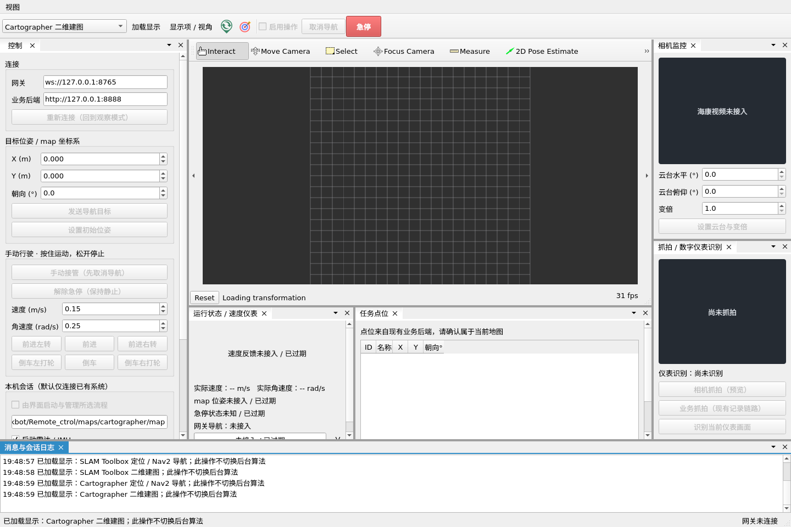

# Qt / RViz2 移植与验证记录

日期：2026-10-15。当前为独立桌面端首版，源界面来自 `/home/jkbot/Ros_Qt5_Gui_App`。

## 已交付

- `desktop_ui/build/robot_desktop` 可执行程序，独立构建、启动与配置。
- 迁移旧窗口表单、停靠布局、图标、媒体资源及速度仪表，保留原许可说明。
- 嵌入真实 RViz2，支持 FAST-LIO、SLAM Toolbox、Cartographer 六种建图/导航显示配置；显示项与视角可按需展开。
- 网关单点导航、初始位姿、取消、急停与手动遥控；RViz 点选先经过桌面适配层再转网关。
- ROS2 位姿、实际速度、电池、视频订阅，数据有效性与过期状态显示。
- 海康云台/变倍、抓拍预览与按需 OCR 接口；业务抓拍复用现有链路。
- 点位列表、保存当前位置、删除点位，数据复用原 HTTP 后端；路线和计划打开原管理页面。
- 显式本机会话启动与自身进程组管理，检测重复管线；分后端调用存图服务及二维栅格导出工具。
- 只在明确操作时写接口，默认观察模式；重连不恢复旧运动请求。手动发布还受独立的反馈超时检查约束，ROS 状态线程停止后不会继续维持运动指令。

## 解耦结果

本轮应用源码及配置全部新增在 `desktop_ui/`。检查时 `git diff --name-only` 为空，原有受版本控制的业务文件未修改；原 Qt 工程也未执行源码修改。已有分析报告和用户的 `项目需求.md` 保留。

没有修改 FAST-LIO、Nav2、底盘桥、速度仲裁、业务后端或网页代码，没有改变原默认启动入口。新目录包含 `COLCON_IGNORE`，不进入原有 ROS2 工作空间构建链。关闭桌面端后可继续使用原方式。

安装了本机缺少的 `libqt5svg5-dev`、`libqt5websockets5-dev`、`qtbase5-private-dev` 和用于无显示器验证的 `xvfb`，以及它们的必要依赖。没有执行系统整体升级；安装过程使用的密码没有写入项目。

## 实际验证

构建命令：

```bash
./desktop_ui/scripts/build.sh
```

构建完成，三个 CTest 程序全部通过，最后一次运行总耗时约 9.93 秒：

| 测试 | 已验证行为 |
| --- | --- |
| `desktop_protocol` | 观察模式不发指令；重连不恢复控制；手动接管等待取消/急停反馈；显式解除急停；速度限幅；松键不再持续发零速度；反馈失效或停止更新后结束运动；目标数值检查及弧度处理 |
| `desktop_ros_services` | 使用真实 ROS2 消息类型与模拟服务验证相机返回图像、云台参数、OCR 文本/置信度、三后端存图请求；服务超时后忽略迟到响应；启动器保持参数原文，停止仅影响自己启动的进程 |
| `desktop_ui_integration` | 在 Xvfb 中运行完整窗口和 RViz；验证实际渲染帧；伪造 TF、里程计、急停及导航状态；通过真实控件测试目标、初始位姿、手动接管、松键与观察模式 |

另外执行 `--smoke-test`，在隔离 ROS 域中依次加载六种模式并正常退出，退出码为 0。虚拟显示器中使用 Mesa 软件渲染，检出 OpenGL 4.5。配置 JSON、三个 RViz 配置的工具话题以及三个 shell 脚本语法均检查通过。

测试日志临时位于 `/tmp/robot_desktop_build.log`、`/tmp/robot_desktop_smoke.log`；CTest 结果位于 `build/Testing/Temporary/LastTest.log`。日志可重新运行生成。

## 尚需实车联调

本次没有启动真实底盘、导航执行器或相机，没有向生产网关发送控制。模拟接口验证不能替代实际设备验收。

实车需依次核对真实话题/TF、电池反馈、松键与失联停车、导航发送/取消、相机云台范围、OCR、各后端地图产物，以及点云和视频负载下的导航控制频率。地图保存目前主要面向同机运行；FAST-LIO 的保存路径必须与既有建图节点配置一致。

自动巡检执行器、多点循环、地图编辑、智能掉头与精确停靠算法未在本次实现。现有网关也仍没有跨网页/Qt 的控制权租约，实车请使用单个操作前端。

## 使用入口

```bash
/home/jkbot/Remote_ctrol/desktop_ui/scripts/run.sh
```

正常运行需要图形桌面。推荐先按原方式启动机器人系统，Qt 连接观察，再逐项启用操作。配置、存图差异及遥控步骤见 [README](README.md)。

离线预览如下，截图未接入实车数据：



## 2026-10-16：本地 ROS2 控制与 FAST-LIO 显示修正

本节替代首版中通过 WebSocket 网关操作车辆的说明。桌面 UI 运行在机器人本机，不再包含网关地址、连接逻辑及 Qt WebSockets 依赖；原 `robot_gateway` 保持不变，继续供异机远程控制使用。

本地接口为 `/initialpose`、`/navigate_to_pose` Action、`/cmd_vel_teleop`、`/emergency_stop` 和 `/capture_request`。导航目标仍经过操作使能、定位及急停检查；手动速度仍经过现有 `twist_mux` 与底盘桥。初始定位不依赖网关或已有的 `map → base_link`，明确设置后等待 ICP 成功。首次运动需点击解除急停；取消导航等待真实终态，迟到接受的目标也会取消。空闲启动不发布速度和急停状态。

现场日志中，11:06 和 11:16 的 UI 会话只完成地图加载，没有执行 ICP；11:20 的终端会话在下发初始位姿后持续 `fitness: 1.000`。主要定位参数一致，没有发现需要修改 FAST-LIO 算法或标定参数的证据。对应修正集中在桌面端初始化位姿通路和 RViz 配置：

- FAST-LIO 导航独立使用 `navigation_fastlio.rviz`，默认显示全局 PCD 和当前扫描。
- 全局 PCD 订阅使用 `Reliable + Transient Local`，与原发布端一致，验证 UI 晚启动也能收到保留的点云。
- 导航视角固定在 `map`，定位前即可观察栅格图并使用 RViz 原生初始位姿工具。
- 建图固定在 `lio_odom`，默认视距从约 217 米调整为 20 米；点样式从 1 厘米实体方块改为固定 3 像素点，避免缩远后几乎不可见。累积显示 `/cloud_registered`，关闭算法默认不发布的显示项。

渲染验证使用隔离域中的真实 PointCloud2 与 OccupancyGrid 消息，检查 RViz 接收状态和截图像素；不能只检查渲染帧计数。测试中首次地图加载仍能出现 `indexed_8bit_image` 着色器日志，但截图已能显示棋盘栅格；该日志不足以单独判断地图显示失败。上游也记录过此类首次加载日志，见 [RViz issue #463](https://github.com/ros2/rviz/issues/463)。

新测试使用模拟 Nav2 Action 与本地 ROS2 接口，不连接生产网关，不启动真实底盘、相机或导航进程。模拟截图存放在 `/tmp/robot_desktop_before_localization.png`、`/tmp/robot_desktop_navigation_render.png` 和 `/tmp/robot_desktop_mapping_render.png`，不代表实车运行效果。实车仍需用更新后的 UI 验证真实点云、初始化定位和到点流程。

最后构建与验证：`./desktop_ui/scripts/build.sh` 成功，三项 CTest 全部通过，总耗时 15.42 秒。测试覆盖本地控制与反馈超时、迟到导航目标的取消、模拟设备服务、真实 RViz 初始位姿点选、Nav2 目标/取消/手动接管，以及地图和建图点云像素检查。检查确认 `ros2_ws/`、`backend/` 和 `web/` 没有修改，桌面程序不再链接 Qt WebSockets。

另已通过六模式 `--smoke-test`，正常退出并生成 `/tmp/robot_desktop_local_smoke.png`。该验证使用隔离 ROS 域 218；本地控制、设备服务和 GUI 测试分别使用 221、220、219，不向实车域发布控制。


## 2026-10-16：目标箭头显示修正

现场日志已记录 `Setting goal pose`，说明 RViz 原生目标工具能够收到鼠标点选；运行图显示工具发布 `/desktop_ui/goal_request`，箭头显示却订阅无人发布的 `/goal_pose`。因此拖动时临时箭头可见，松开后没有持久显示。另发现 Nav2 自身订阅 `/goal_pose`，修正中没有向该话题补发目标，避免绕过本地操作检查或重复创建导航请求。

导航配置的箭头改为专用 `/desktop_ui/selected_goal`，由桌面 ROS 适配器发布预览。鼠标点选与数字坐标发送共用该显示通路，点选同步填入左侧坐标框。预览与 Nav2 Action 请求分别处理，操作条件不满足时仍能看到所选位置，同时保留实际导航拒绝原因；观察模式的点选不发送 Nav2 目标、速度或急停。

GUI 集成测试增加真实 `SetGoal` 鼠标拖动，检查松开鼠标后的红色箭头像素、预览消息及数值输入的预览同步，并检查观察模式没有导航或运动输出。测试截图位于 `/tmp/robot_desktop_selected_goal.png`，使用隔离 ROS 域和模拟地图。

验证完成：三项 CTest 全部通过，总耗时 10.68 秒；箭头测试在松开鼠标后检出 21 个明显红色像素（点选前为 0），并确认观察模式没有 Nav2 目标、速度或急停输出。箭头尺寸同步调大，便于在默认视距下观察。当前实车进程未重启，也未代替操作员点选或发送实车目标。


## 2026-10-16：海康相机监控接入

“相机监控”增加独立的 `CameraPanel`，与导航进程使用不同的 `ProcessManager`。可以启动相机、连接已有节点、恢复/停止取流、查看实时图像/分辨率/预览帧率和过期提示、保存当前画面、读取设备坐标/变倍范围，以及按住控制方向和变倍。退出界面回收自身相机进程；不关闭外部启动的相机，切换或停止导航也不关闭相机。右侧面板支持滚动，默认宽度已扩大。

启动复用 `hk_camera_params.yaml`，桌面 JSON 只新增参数文件路径，不复制账号/密码；启动命令不携带凭据。相机保持独立 ROS2 节点，SDK 不链接进桌面或导航进程。监控启动覆盖关闭人脸抓拍，既有相机 launch 默认行为保留。

修正驱动两处实际接口问题：

- `/hk_camera/set_ptz_pose` 原先把水平角强转成预置点编号，忽略俯仰和变倍；现按 SDK 绝对坐标编码处理。新增 `GetPTZPose` 读取设备坐标和范围，新增 `ControlPTZ` 接收方向、速度和停止，兼容外部 RS485 云台。普通预置点接口和原独立相机 Qt 程序保留。
- `/hk_camera/capture` 空保存路径原先写入另一台机器的目录；现使用临时 JPEG 返回图像并清理。指定路径则先创建父目录；同时检查质量和图像解码结果。取流开始/停止操作改为幂等，便于连接已有节点。

实机通过只读 ISAPI 返回相机型号 `iDS-2ZMN2307S(E)`、RS485 PELCO-D 配置；SDK 返回光学变倍范围 1～23 倍，水平/俯仰范围均为零。界面禁用这两个绝对角度输入，显示反馈不可用，使用方向按钮控制外部云台；支持绝对坐标的机型按其范围开放。SDK 方向操作参考 [海康官方接口说明](https://open.hikvision.com/hardware/definitions/NET_DVR_PTZControlWithSpeed_Other.html)，启动和停止分别发送。

方向控制需“启用操作”和有效视频，固定 SDK 3 档。界面每 150 ms 续期，松开、失活、取消使能、视频过期时发送停止；驱动 100 ms 检查一次，500 ms 无续期则停止，失败重试。读数或设置服务不与本界面的按住操作并行。设置成功仅代表设备接受，不代替实际到位验收。

实际完成的验证：

- `hk_camera` 节点与原独立 GUI 均重新编译成功；`test_ptz_codec` 和既有人脸数据解析/存储测试通过。新增编码测试验证海康的压缩十进制、0.1 单位、非法输入、跨零范围及未上报范围。
- 新增 `desktop_camera` 模拟测试，隔离 ROS 域 222。验证登录/取流顺序、真实 QLabel 图像像素和 BGR 转换、过期清屏、云台设备范围、1～23 倍设备的角度输入限制、按住续期及松开/取消使能/窗口失活/视频过期后的停止、离线模式禁止操作。
- 桌面四项 CTest 和六模式离线 smoke 均通过，原有导航/地图点云渲染测试继续通过。
- 在隔离 ROS 域 223 实际启动相机，接收 1920×1080 RGB 视频、读取云台/变倍信息，SDK 原图抓拍成功返回 1920×1080 BGR。随后通过界面真实按钮启动相机、显示视频、读取设备信息和停止自身进程；单独的实机只读测试通过，截图位于 `/tmp/robot_desktop_camera_live.png`。
- 没有向真实底盘发送运动/导航请求，没有对真实云台下发转动或变倍。方向、变倍实际动作与镜头到位效果仍需现场验证；测试结束后自身相机进程已回收。

构建与自动测试：`./desktop_ui/scripts/build.sh`。只读实机验证需显式执行（会启动相机取流，不操作云台）：

```bash
source /opt/ros/humble/setup.bash
source ros2_ws/install/setup.bash
QT_QPA_PLATFORM=offscreen ROS_DOMAIN_ID=223 ROS_LOCALHOST_ONLY=1 \
  DESKTOP_CAMERA_LIVE_TEST=1 ./desktop_ui/build/desktop_camera_test liveCameraPreview -v1
```

本次与相机有关的原工程修改局限于 `ros2_ws/src/hk_camera/`；未改导航算法、底盘或网关。此前按用户要求修改的三种导航 20 cm 终点位置容差继续保留。


## 2026-10-16：SLAM Toolbox 纯定位切换 AMCL

按用户本轮要求，将原 SLAM Toolbox 导航定位端切换为 AMCL，SLAM Toolbox 建图和保存保留；TEB 本轮按用户要求略过。

- 新增 `chassis_nav2/launch/amcl_localization.launch.py`，原 `slam_2d_localization.launch.py` 兼容转入该入口。新增 `config/amcl.yaml`，只需现有 YAML/PGM 地图；不再读取 posegraph/data。旧 `map_file` 参数兼容接收但不使用。
- 建图模式运行 `async_slam_toolbox_node`；定位模式只运行 `nav2_amcl/amcl`。Map Server 与 AMCL 由同一个定位生命周期管理器按顺序配置/激活，导航节点使用独立管理器。
- TF 链为 `map --AMCL--> odom --轮速+IMU EKF--> base_link`。默认等待 `/initialpose`，不自动假定原点；收到有效扫描后建立地图 TF，并让等待定位的 Nav2 继续激活。支持停车取消导航后重新给初始位姿。
- UI 原 `slam_navigation` ID 保留，名称更新为“AMCL 定位 / Nav2 导航”，地图目录继续为 `maps/slam_toolbox/`。启动参数不再传序列化地图前缀，重复启动检测增加 AMCL 节点；原有操作使能、初始位姿和导航使能检查继续使用。
- 为 Qt 和独立 RViz 分别新增 AMCL 显示配置，包含地图、激光、定位位姿、粒子云、路径和目标箭头。视角固定 map，定位前可观察地图并给初始位姿；独立 RViz 保持 `/initialpose`、`/goal_pose`，Qt 保持自身检查后的请求话题。
- FAST-LIO、Cartographer 和 SLAM Toolbox 建图的定位/建图节点配置保持原流程。三种导航的终点位置容差 20 cm 和既有朝向容差保留。阿克曼转弯、掉头、停靠控制算法没有在本轮更换。

构建与验证：

1. `chassis_nav2` 构建成功，AMCL 已安装，无需额外安装依赖；部署脚本与 package.xml 补充显式依赖。新旧两个启动入口均通过 `--show-args` 检查。
2. 导航离线回归 25 项通过，覆盖 FAST-LIO TF 来源、几何/里程计和底盘控制既有逻辑；新增验证 AMCL 不依赖序列化地图、定位与建图不混用、生命周期管理，以及 Cartographer 独立配置。
3. ROS 域 214 中运行真实 AMCL、Map Server 和 Nav2，使用合成栅格、激光与里程计 TF。验证给初始位姿前不发布地图 TF、初始化、0.6 m 模拟位移跟踪、重新定位和七个 Nav2 节点激活，运行测试通过。旧命令别名携带自定义 map 参数也已实际验证。为缩短测试启动时间，测试副本只缩小 Smac 查找表，实车规划参数不变。
4. 四组桌面测试通过，包括 AMCL 启动参数、实际 RViz 工具在地图 TF 建立前发送初始位姿、定位位姿/粒子云插件加载，以及原有导航、相机和图像渲染检查。切换 RViz 配置后的工具测试等待新视角完成渲染，避免在相机投影尚未更新时立即点选。

日志位于 `/tmp/amcl_chassis_build_final.log`、`/tmp/amcl_navigation_final.log`、`/tmp/amcl_runtime_final.log`、`/tmp/amcl_desktop_checks_final.log`。六模式离线 smoke 截图位于 `/tmp/robot_desktop_amcl_smoke.png`。

本轮没有启动实车驱动、雷达/IMU 或底盘控制桥，也没有下发实车导航目标。基准 AMCL 参数和实际地图/激光匹配效果仍需现场验证。完整启动、初始化和回归命令见根目录 [2D 建图导航](../2d建图导航.md)。

## 2026-10-16：FAST-LIO 保存后自动导出 PGM/YAML

“保存当前建图产物”在 FAST-LIO 建图模式下执行 `/map_save` → 检查新 PCD → `pcd2pgm` 切片 → Nav2 `map_saver_cli` 导出，生成同前缀 `.pcd/.pgm/.yaml`。导出由桌面侧独立 Python 进程管理，建图继续运行；每次使用独立命名空间和话题。参数放在 [fastlio_map_export.yaml](config/fastlio_map_export.yaml)，默认高度 -0.10～2.0 m、分辨率 0.05 m、半径 0.2 m、6 邻点、超时 180 s。

测试发现本机 Nav2 工具将原点 `10.123456… / 20.234567…` 序列化为 `10.1 / 20.2`。新流程从本次投影消息写回完整原点与分辨率，不额外变换 PCD 坐标。栅格先保存到临时目录，检查 PGM 尺寸和数据长度后再替换文件；普通写入错误回滚旧栅格，切片失败/超时保留 PCD 和旧栅格，清理自身导出进程。

验证结果：

- 桌面构建成功，五组 CTest 全部通过（34.35 s）。新增 ROS 域 213 的存图测试实际运行切片与 Nav2 存图，覆盖路径空格/中文/引号、原点精度、旧 `/projected_map` 不串入、重复点击、过滤为空、服务成功但无 PCD、超时、失败重试和进程回收。
- ROS 域 212 中只读使用现有 184,463,357 字节 PCD（5,764,472 点），向临时目录导出成功，耗时 51.54 s；得到 375 × 348、5 cm 栅格，含 118,861 个空闲像素和 11,639 个障碍像素。检查原 PCD 修改时间和原 PGM/YAML 哈希保持不变。预览位于 `/tmp/desktop_fastlio_export_preview.png`。
- 注入第二个文件替换失败，验证旧 PGM/YAML 成对恢复。测试未调用真实建图服务或发送实车运动命令。

本次修改位于 `desktop_ui/`。当前已经打开的桌面程序需退出并重新启动，才会使用新的保存流程。

## 2026-10-16：修复停止建图后 PCD 被清空

现场 `maps/fastlio/map.pcd` 在 15:09:32 变为零字节，PGM/YAML 仍为 15:09:23 导出的文件；建图日志显示 15:09:05 调用保存，15:09:32 停止时 FAST-LIO 以 SIGINT 退出。原桌面停止向整个进程组发送 SIGINT，`ros2 launch` 随后再次向节点转发 SIGINT；FAST-LIO 退出时又直接覆盖保存 PCD，PCL 的 `O_TRUNC` 使已保存地图可能在中断时被清空。此前仅覆盖导出流程，缺少保存后停止的完整运行测试。

修复内容：

- PCD 写入同目录唯一临时文件，写入成功且非空后再替换目标；普通失败清理临时文件，中断不会先截断原 PCD。
- 显式 `/map_save` 成功后保留这份快照，退出不再次覆盖，保持它与已导出的栅格对应。继续建图后需再次点击保存更新地图；未显式保存时仍尝试退出自动保存。
- 桌面先向启动器发送一次 SIGINT，由启动器转发，重复停止请求忽略；超时仍只向自身进程组升级终止信号。UI 及命令行导航入口在启动前拒绝空 PCD。

验证结果：

- `fast_lio_localization`、`chassis_nav2` 及桌面构建成功。C++ 存图测试覆盖正常保存、写入失败、空输出及子进程写入后被杀死，旧 PCD 均保持可读。
- 五组桌面 CTest 全部通过（27.39 s），新增测试验证启动器只转发一次 SIGINT，连续点击两次停止仍能让子进程完成保存。导航离线回归 25 项通过，包含空 PCD 拒绝启动。
- 新增 [test_map_save_runtime.py](../ros2_ws/src/FAST_LIO_LOCALIZATION_ROS2/tests/test_map_save_runtime.py)：ROS 域 211 内实际运行 FAST-LIO，输入合成雷达/IMU，保存并切片，继续积累点云，再停止建图。三份地图文件哈希保持不变；地图发布节点成功重新加载 1,382,649 字节 PCD，发布 5,505 个降采样地图点。运行测试通过（16.563 s），无实车驱动或运动命令。日志：`/tmp/fastlio_map_save_runtime.log`。

最新零字节 PCD 无法从二维栅格完整恢复。已将 15:04:58 保存的 `map_20261016_150614.pcd` 备份另存于 `maps/fastlio/recovered_20261016_150458/`，原始副本为 `source_raw.pcd`。该备份大量重复点导致原始切片达到 180 s 超时；恢复用 PCD 进行 2 cm 体素降采样（5,192,624 → 31,126 点），坐标系保持，随后实际导出匹配的 194 × 369 栅格并验证 Open3D 可读。导出约 1.92 s。恢复地图前缀：`/home/jkbot/Remote_ctrol/maps/fastlio/recovered_20261016_150458/map`；详细来源见目录中的 `RECOVERY.txt`。当前默认地图与所有原始备份保持原状，不能将最新栅格与这份旧 PCD 混用。

## 2026-10-16：本地二维地图编辑器第一版

按 [地图编辑开发计划](../地图编辑开发计划.md) 的 P0～P4 实现本地栅格编辑的第一版。功能保持在 `desktop_ui/`，不修改 ROS2 导航、定位、底盘或网关代码。

已实现：

- 独立 `desktop_map_editor` 库：`MapDocument` 文档模型、`MapIo` 的 P5/YAML 读写与校验、`MapEditCommand/MapHistory` 像素差分与撤销重做。
- 主窗口新增“地图编辑”入口，观察/离线模式也可使用；本机会话区新增“导航栅格 YAML”覆盖项。编辑图只替换三套导航的 `map:=...`，FAST-LIO 的 `pcd_map` 和 Cartographer 的 `map_file` 仍保留原前缀。
- 编辑窗口支持障碍/空闲/未知三态画笔、直线预览、笔刷格数与米数、缩放/平移/适应窗口、未保存提示、撤销/重做和版本化另存。
- “另存为”先写新 PGM 并回读校验，再原子提交 YAML；目标已存在时先备份旧 YAML 和它引用的图片。源 YAML、源 PGM 的哈希和修改时间不自动改变。
- 使用真实阈值推导画笔编码，不写死 205。当前三套地图 `free_thresh=0.25` 下，205 的真实 Map Server 语义是空闲；未知区域会写成阈值之间的合法灰度。

验证结果：

- 源码构建成功，8 组桌面 CTest 全部通过：原有 5 组 + `desktop_map_editor`、`desktop_map_editor_ui`、`desktop_map_editor_nav2`。
- `desktop_map_editor` 覆盖 P5 注释/首像素空白与 #、非法长度/16 位/P2、`negate=0/1`、非零原点与 yaw、撤销重做、目标备份和中文/空格/引号路径。
- `desktop_map_editor_ui` 在 offscreen 环境用真实鼠标事件绘制三态笔刷、直线入口、撤销/重做和保存，确认保存后 dirty 状态清除。
- `desktop_map_editor_nav2` 调用 Humble 的真实 `nav2_map_server::loadMapFromYaml`：编辑器写出的未知、空闲、障碍分别加载为 `-1/0/100`；同时验证现有 `free_thresh=0.25` 下 205 灰度加载为空闲。
- 使用项目当前三套实测地图做只读加载检查：FAST-LIO 239×501、SLAM Toolbox 245×290、Cartographer 376×186，元数据、像素长度和 origin 精度均通过 `MapIo` 读取。
- 未修改 `maps/` 下任何实测地图；编辑测试全部使用临时合成地图。未进行实车导航验证。
- 使用合成 200×120 地图生成离线预览 `desktop_ui/docs/map_editor_preview.png`；截图不包含实车数据。
