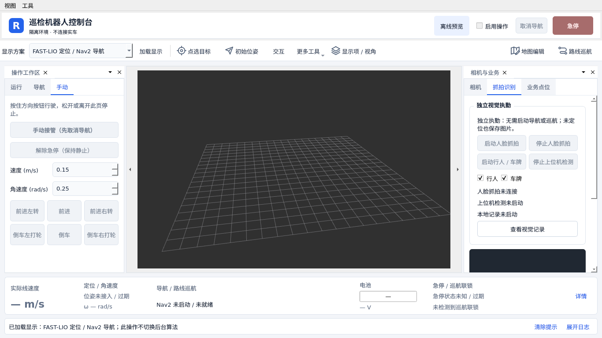

# 独立视觉执勤实现与验证记录

> 本文是 2026-10-18 海康原生人脸版的历史记录。2026-10-19 已切换为 YuNet / YOLO26n / LPD-YuNet 全上位机方案，当前使用方法和验证见 [全上位机视觉改造记录](全上位机视觉改造记录.md)。

日期：2026-10-18。环境：Ubuntu 22.04、ROS2 Humble、Qt 5.15。

本次按用户最新要求，将海康人脸抓拍与上位机行人/车牌检测做成独立功能。启动、停止不依赖导航模式、定位成功、巡航任务、计划调度、车辆操作许可或解除急停。可用于静止执勤。

## 使用入口

右侧 **“抓拍识别 → 独立视觉执勤”** 位于该页顶部：



- 启动人脸抓拍 / 停止人脸抓拍。
- 启动行人 / 车牌 / 停止上位机检测；行人、车牌可分别勾选。
- 查看视觉记录：打开独立历史窗口，筛选、分页、查看图片及小车坐标。

首次启动只复用或启动相机、记录与所需检测组件。切换导航显示方案、停止导航流程、切换 UI 页签或隐藏面板，不会调用视觉停止。关闭历史窗口继续记录；退出整个桌面端时回收自身进程，保留外部节点。

运行命令、ROS 接口及数据目录见 [vision_events README](../ros2_ws/src/vision_events/README.md)。UI 正常启动：

```bash
cd /home/jkbot/Remote_ctrol
./desktop_ui/scripts/run.sh
```

`--offline` 用于离线预览，真实视觉启停禁用。

## 已实现内容

| 部分 | 实现 |
| --- | --- |
| 海康相机 | 复用原生人脸小图与 JSON；新增 SDK 接收启停服务、状态、保存/丢弃计数；停止新接收时继续处理队列；原生 JSON 原子写入 |
| 上位机 | 移除人脸比对路径，直接复用已有 OpenVINO YOLO；一个模型处理行人与车辆；车牌使用 HyperLPR3；可选 ROS 图像或 RTSP/录像输入；限帧和最新帧策略 |
| 轨迹规则 | 行人连续轨迹一次记录；车牌同轨迹/号码多帧确认一次记录；不再使用旧版区域 10 分钟或车牌 30 分钟静默；海康不同抓拍全部分别记录 |
| 本地记录 | 独立 `vision_events` 节点，SQLite、原始 JPEG 小图副本、异常记录、补扫恢复、消息幂等、分页查询、可选地图标记 |
| 位姿 | 依据事件时间匹配历史 `map→base_link`；未定位、过期、地图未标记时保存图片并明确标记坐标无效，不填写零坐标 |
| Qt | 独立启停按钮、组件状态与过期提示、历史图片和坐标；保留手动抓拍和数字仪表 OCR；不引入导航控制动作 |
| 后台兼容 | 可选事务 outbox、按事件 ID 幂等接收、旧数据库增量迁移和受控本地媒体接口；默认不上报、不依赖后台 |
| 部署 | CPU 依赖安装脚本与固定版本、独立命令、CLI 查询、工作区与 Qt 构建接入 |

上位机不初始化 YuNet/SFace、不读取 `face_db`，没有姓名、登记人员或身份比对功能。海康同一人的多次抓拍保留为不同记录，消息重放仅恢复同一原始事件。

为减少运行依赖，推理直接使用已有 OpenVINO 导出模型，没有引入 PyTorch/Ultralytics 运行依赖。原 ByteTrack 路径改为轻量 IoU 关联和可配置轨迹超时；遮挡、漏检可能产生新轨迹，不作为跨场景人员身份跟踪。

## 验证结果

- 相关 ROS 包构建通过：`vision_interfaces`、`vision_events`、`detector_node`、`hk_camera`。
- 视觉 Python 测试 **12 passed**，包括纯记录逻辑、历史坐标匹配、数据库迁移与幂等、媒体路径约束，以及隔离 ROS 实例测试。
- Qt 桌面 CTest **12/12 passed**（最终一轮 49.21 s）；新增 `desktop_vision` 验证无导航和无车辆操作许可时启停、开启过程中请求停止、切页保持、历史查询及离线禁用。布局测试确认 1366×768 与 1920×1080 下两组启动按钮在页签打开后可见。
- 海康已有抓拍保存与云台编码测试 **2/2 passed**，未调用实机 SDK 操作。
- 模拟同一 face_id 的 20 次不同抓拍，保存 20 条；重放/补扫不增行；无定位仍产生可读图片且坐标为空。
- 模拟车辆从 x=1 移动到 x=9，延迟处理早先事件，记录保留 x=1；地图会话变化后不使用新会话位置填旧记录。
- OpenVINO 实模型读取官方公开 bus.jpg，检出 3 个行人与 1 辆公交；通过 ROS 图像输入和本地记录节点的端到端验证，在无导航、无定位情况下保存 3 条可读行人图片记录，记录错误数为 0。
- HyperLPR3 实模型已完成加载与空白图推理；该测试不证明实际车牌识别准确率。

完整桌面测试包含地图编辑、相机、服务适配、巡航页面、真实 RViz 模拟渲染与窗口生命周期回归。测试使用隔离 ROS 域、假相机消息/TF/服务、临时数据目录和 Xvfb，没有启动底盘、连接真实相机或发送运动目标。

后续复核可查看 `desktop_ui/build/verification/` 中的构建与测试日志。该目录是本机构建产物，不提交 Git。

## 时间与现场边界

海康消息当前为主机 SDK 报警接收时间，可能晚于实际曝光，记录位置是该时间的近似。没有明确地图标记或新鲜 TF 时仍保存图片。要记录有效地图坐标，可在历史窗口中关联当前实际地图标记；这项操作只设置记录上下文，不启动导航。

待现场验证：设备 `facesnap` 规则与真实启停、不同距离/光照/遮挡的行人和车牌效果、实际报警延迟、移动时位置误差、导航并行负载与长期磁盘容量。用户不在车辆旁，P6 保持待验收。
