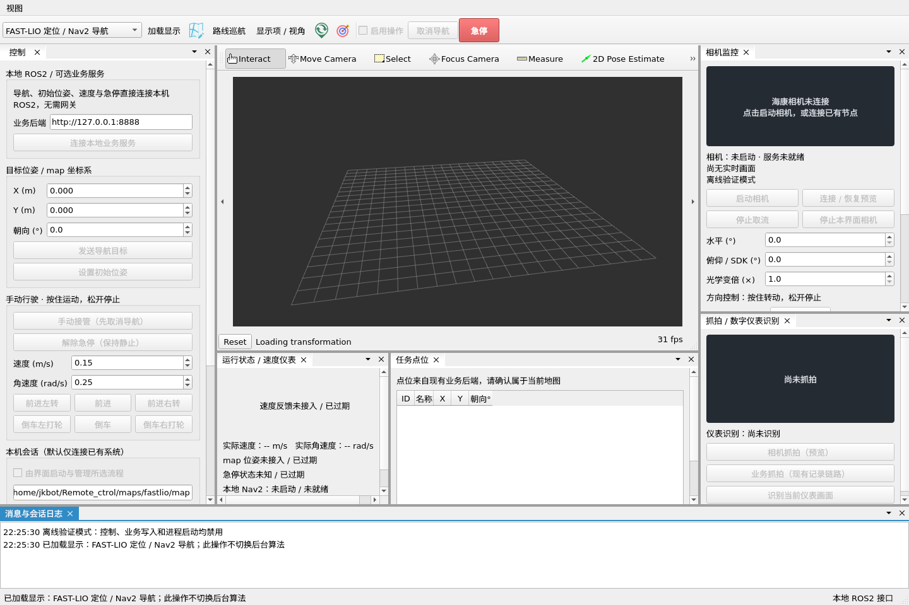
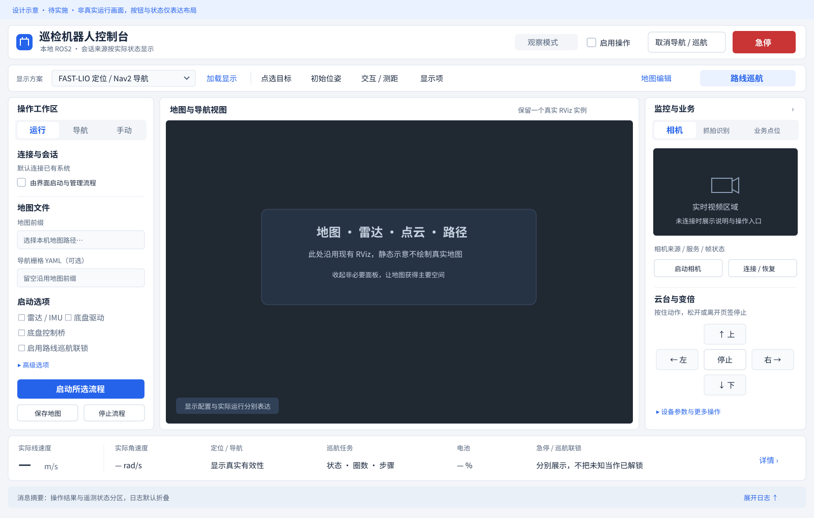

# 主界面 UI 美化开发计划与实施交接

编制日期：2026-10-17。项目：`/home/jkbot/Remote_ctrol`。环境：Ubuntu 22.04 / ROS2 Humble / Qt 5.15 / C++17。

**状态：2026-10-18 已实施主界面改造，实际结果与验证记录见第 13 节。** 配套 SVG 保留为设计参考，当前界面以代码和实际运行截图为准。制定计划时的基线为 `9b5a363e972abd83a74ab2a83e9542a9a3510b84`（实现目标级巡航联锁与桌面联锁识别）。继续迭代时重新检查 HEAD 和工作区，保留已有改动。

用户当前不在车辆旁，本轮实施和验收以离线 GUI、隔离 ROS 模拟接口为主。实车运动、定位精度和相机机械动作不作为本次 UI 美化完成条件。

## 1. 目标与范围

把当前功能堆叠的工程界面整理为**以地图为中心、操作分组清楚、关键状态常驻的本地控制台**。

设计方向：浅灰背景、白色面板、蓝色主操作、深色 RViz / 视频画面；优先改善布局、信息层级和可读性。第一版只做一套浅色主题，不增加主题切换功能。

本次范围：

- 主窗口布局、间距、字体、图标、按钮层级、空白状态及状态展示。
- 左侧“运行 / 导航 / 手动”页签，右侧“相机 / 抓拍识别 / 业务点位”页签。
- 常驻的操作许可、取消、急停区域，以及紧凑的车辆状态概览。
- 日志折叠、紧凑屏幕适配、恢复默认布局及仅限展示的布局记忆。
- 既有功能入口与现有测试对新布局的适配。

定位、规划、控制、地图格式、巡航任务状态机和硬件协议沿用现有实现。地图编辑和路线巡航继续使用现有独立窗口，本次只统一入口，不重新设计其内部页面。远程网关和网页不参与本地 UI 的启动与运行。

## 2. 当前界面依据

本次使用当前程序 `--offline` 在 Xvfb 中实际打开并截图，没有启动底盘或传感器。



已确认的问题：

1. 左侧连接说明、目标输入、手动控制、会话参数纵向堆叠，运行配置落到滚动区域下方。
2. 相机控制与抓拍识别上下分割，同时占用右侧高度，视频本身的可用面积较小。
3. 地图下方的速度仪表和业务点位表长期占位；未连接时大片空白，地图空间被压缩。
4. 主工具栏与 RViz 原生工具栏同时展示，图标风格、语言和动作入口不统一。
5. 默认 Qt 控件、旧表盘、深色预览和 Dock 标题栏缺少统一视觉层级。
6. 运行、定位、导航、急停、巡航等状态分散，用户需要逐块阅读文本。
7. 初始窗口使用 `resize(1440, 960)` 和若干固定 splitter 数值，未按当前屏幕可用区域安排初始大小。

上述截图没有真实数据；不能以截图中的“未接入”判定功能缺失。拍摄正常数据状态时使用明确标注的模拟数据或后续现场截图。

## 3. 目标布局



示意图只表达区域和视觉方向，地图、数据和按钮状态不代表当前实车状态。

| 区域 | 布置与职责 |
| --- | --- |
| 顶部常驻栏 | 应用名称、当前显示方案及简短会话来源；右侧固定“启用操作”“取消导航/巡航”“急停” |
| 地图上方工具行 | 当前六模式选择、加载显示、点选目标、初始位姿、显示项；地图编辑和路线巡航入口保持可见 |
| 左侧工作区 | 三个页签“运行 / 导航 / 手动”，一次只展示一类操作；每页可独立滚动 |
| 中央地图 | 单个现有 `RvizHost`，获得剩余主要空间；保留地图、雷达、点云、路径、代价地图及视角功能 |
| 右侧工作区 | 三个页签“相机 / 抓拍识别 / 业务点位”；可整体收起，收起后有明确恢复入口 |
| 底部状态概览 | 实际速度、定位、Nav2 / 巡航摘要、电池、急停与巡航联锁状态；点击详情查看完整信息 |
| 底部日志抽屉 | 默认折叠，只显示最近消息和“展开日志”；用户展开后可调整高度 |

继续使用现有 Advanced Docking System，采用固定的顶部安全栏和可调整的工作区。第一轮不同时更换 Dock 库或引入 QML、WebEngine、前端框架。右侧整体作为一个 Dock，其内部采用页签；不再默认平铺三个独立 Dock。

## 4. 各区域具体方案

### 4.1 顶部与地图工具行

- 急停固定在右上方，建议宽 88～104、高 40～44 个逻辑像素，红底白字并保留“急停”文字。
- “取消导航/巡航”与“停止本界面流程”分开，前者是任务操作，后者只属于运行页。
- 取消按钮继续依据当前任务调用已有协调路径；巡航活动时可显示“取消巡航”，空闲或单点导航时沿用原文案。
- “启用操作”继续使用真实可见的 `QCheckBox`，可通过容器及样式强化观察/操作状态，不改成隐含在图标中的开关。
- 顶部显示“观察模式 / 操作已启用”；模式来源来自现有状态，不能因按钮变蓝而自动授权。
- 六模式 `profileSelector` 继续复用现有枚举，不在本次拆成两套可能互相冲突的算法/模式选择器。
- 明确区分“显示方案”与“实际会话”：切换显示不能显示为已启动算法，外部会话无法核实算法时显示“外部会话，来源待确认”。
- 工具行在窄窗口可把“加载显示 / 显示项”等低频项放入“更多”；急停、取消、操作许可不得进入溢出菜单。
- 地图编辑、路线巡航维持独立窗口入口。启用巡航联锁时，单点目标的限制继续生效，并给出可见原因。

### 4.2 左侧“运行”页

按“连接方式 → 地图 → 启动选项 → 会话操作”组织：

1. 保留“由界面启动与管理所选流程”选项；未勾选时明确显示“连接已有系统”。
2. 显示地图前缀、可选导航 YAML；长路径不撑宽侧栏，提供浏览及完整路径 tooltip。文件选择只填写字段，不隐式启动或切换地图。
3. 常用项显示雷达/IMU、底盘驱动、底盘控制桥、巡航联锁；里程计等技术参数放入可折叠“高级选项”。
4. 巡航联锁说明使用产品文案：“支持多点路线巡航；开启后请通过路线巡航下发目标，单点导航入口禁用”。节点名和 mux 细节放在帮助或 tooltip 中。
5. “启动所选流程”为主按钮；“停止本界面流程”为次按钮；“保存地图”在建图模式可用，导航模式展示禁用原因。
6. 显示由界面管理还是外部启动；只有现有进程管理器拥有的会话才允许停止。

可选 HTTP 业务服务地址移到右侧“业务点位”页或该页的“连接设置”，不再占据左侧第一块区域。业务服务断开不能把本地 ROS2 控制台整体显示为离线。

### 4.3 左侧“导航”页

- 保留地图点选目标、X/Y/朝向输入、发送目标和设置初始位姿。
- 单位紧靠输入值，朝向显示度、内部仍用弧度；保留输入范围与精度。
- “发送目标”为蓝色主操作，“设置初始位姿”为普通按钮，二者不共用点击动作。
- 显示可见的禁用原因，例如“请启用操作”“等待 map 定位”“巡航联锁会话请使用路线巡航”。
- 原本允许的观察模式点选预览、FAST-LIO 尚无 map TF 时的初始位姿操作继续保留；不新增统一门槛阻断这些路径。
- 底部提供“打开路线巡航”次级入口，复用原有独立页面，不把完整路线表重新塞进主界面。

### 4.4 左侧“手动”页

- 上部为“手动接管”和真实就绪状态，其次为速度上限与角速度输入，下部为六个方向按钮。
- 方向按钮保持前进/倒车与打轮文字，可增加统一 SVG 箭头；不要只剩容易误解的箭头图标。
- 保留“按住运动，松开停止”常驻说明，不使用点击切换持续运动的交互。
- “解除急停（保持静止）”独立显示，保留原有停稳与目标终止条件。
- 离开手动页、隐藏/关闭所在 Dock、切换紧凑布局或恢复布局时，结束当前按住输入，调用已有 `stopManual()`；再次进入页面不能自动恢复速度。
- 页签切换停止当前输入不等于取消整条巡航，也不自动解除急停；已有任务协调仍由原控制逻辑负责。

### 4.5 右侧“相机 / 抓拍识别 / 业务点位”

| 页签 | 展示与交互 |
| --- | --- |
| 相机 | 视频位于上方并保持宽高比；连接状态和最近帧信息紧随其后；启动/连接、方向控制、变倍、保存画面分组；设备参数默认折叠 |
| 抓拍识别 | 大图预览、识别结果与置信度展示、抓拍/OCR 按钮；原有“预览抓拍”与“业务留档抓拍”的含义分开 |
| 业务点位 | 复用旧 HTTP 点位表及连接配置，明确“业务后端点位”；刷新/采点/删除/打开旧计划管理保持原功能 |

- 原本地路线巡航的点位仍由 `robot_patrol` 管理，不与旧业务点位表自动合并或迁库。
- 切换相机页签、收起相机区、隐藏 Dock 时，结束当前按住的云台/变倍动作，复用相机现有停止路径；恢复显示不能重发旧方向命令。
- 普通页签切换不停止相机进程，不重新登录，不自动抓拍或调用 OCR。
- 空白状态统一为图标、简短说明、当前可用操作；操作按钮的 enable 条件继续来自原逻辑。
- “设备不支持绝对角度反馈”“视频过期”继续如实表达，不能用美化后的数字替代未知状态。

### 4.6 底部状态概览与日志

第一版状态概览包含：实际线速度、实际角速度、定位有效性、Nav2 / 巡航摘要、电池、急停及巡航联锁摘要。较窄时，位姿详情和电压收进详情区，关键告警仍保持可见。

- 速度优先用大数字显示，单位统一为 `m/s`；倒车保留负号。旧仪表可放入“速度详情”折叠区，避免大表盘长期占据地图高度。
- 如保留 cm/s 辅助读数，应明确标注单位，不直接改动 ROS 数值或限速参数。
- 未接入和过期均显示 `—` 及原因，不能把缺失反馈绘成 `0.00 m/s`、`0%` 或健康绿色。
- `RobotSnapshot.guardReady` 与 `patrolLocked` 分别展示：目标 UUID 确认期间可能“guard 就绪但速度锁定”，不能合并为单个“正常”标签。
- 未启用巡航联锁的普通导航会话显示“巡航联锁未启用”，不作为系统故障；收到联锁但反馈过期时显示“状态过期”，不显示“已解除”。
- 巡航状态优先显示任务状态、圈数和步骤；普通 Nav2 空闲刷新不能覆盖正在暂停/执行的巡航摘要。
- 定位状态仅依据现有有效 TF/反馈表达；本次不新增 ICP 分数、定位精度、雷达在线数等无来源的状态。
- 日志沿用已有内容和最大行数，默认折叠。最近消息显示在独立摘要区，过长省略并可查看完整文本。
- 定时遥测刷新不覆盖尚未处理的操作失败提示；错误可手动关闭或由相关操作成功替换。
- 第一版不改写日志系统，不通过猜测任意文本颜色来替代真实错误状态，也不因新日志自动抢焦点或扩大窗口。

## 5. 视觉规范

| 项目 | 第一版约定 |
| --- | --- |
| 页面背景 | `#F3F5F9` |
| 面板背景 / 边界 | `#FFFFFF` / `#DCE3EC`，1 px 细边界 |
| 主要 / 次要文字 | `#17253B` / `#52627A` |
| 主要操作 / 选中态 | `#2563EB`，浅蓝选中背景 `#EAF1FF` |
| 正常 / 提醒 / 错误 | `#15803D` / `#B45309` / `#C93434`；搭配文字与图标 |
| 画面容器背景 | `#202832`；RViz 渲染内容沿用配置，不改栅格编码或点云颜色语义 |
| 间距与圆角 | 间距按 4/8/12/16/24；常规圆角 6～8，不用大面积阴影和渐变 |
| 控件尺寸 | 普通按钮及输入框约 32～36 逻辑像素高，方向按钮至少 44；字体缩放后按布局自然增长 |
| 字体 | 优先系统中文无衬线字体；正文约 10～11 pt，标题约 12～14 pt，数字约 20～24 pt；系统缩放优先 |

- 蓝色主按钮每个操作分组最多一个，删除/停止使用文字和边界区分；红色实心主要用于急停及明确危险状态。
- 图标采用统一线宽的 SVG 或 Qt 标准图标，加文字；检查现有 `reloc2.svg`、`goal.svg`、`edit.svg` 等资源在浅色背景下的可读性。
- 正常、悬停、按下、选中、禁用、键盘焦点状态完整；禁用文字仍可辨认，tooltip 和附近文案解释原因。
- QSS 限定到新工作区容器及明确角色，不使用覆盖整个应用的 `QWidget`、`QPushButton` 通配样式。
- 地图编辑窗口、巡航窗口及 RViz 属性树默认不继承主界面专用皮肤；业务功能不依赖颜色判断。
- 不引入外部在线字体、动画背景或图片生成服务；资源随安装包分发。

## 6. 屏幕适配与布局记忆

以 Qt 逻辑尺寸计算，第一版验收：

| 场景 | 要求 |
| --- | --- |
| 1920×1080 / 100% | 左侧约 280～300、右侧约 300～340；中央地图宽度争取占工作区 65% 以上 |
| 1366×768 / 100% | 左侧约 270～290、右侧约 300；默认地图渲染区目标不小于 700×440，底部日志折叠；关键按钮不出屏 |
| 约 1100×680 的紧凑窗口 | 默认收起右侧，明确提供“相机与点位”恢复入口；左侧可滚动，地图仍可操作 |
| 125% / 150% 缩放 | 依据实际可用逻辑尺寸进入紧凑布局；初始窗口受屏幕 `availableGeometry` 限制，不用固定最小尺寸强行撑出屏幕 |

图中尺寸是设计目标。实施时用实际 RViz 渲染控件测量，不用外层 Dock 几何冒充地图面积。用户主动打开 RViz 属性树后允许地图变小。

- 初始尺寸取当前屏幕可用区域的合理比例；不要沿用固定的 `1440×960` 或初次 `setSplitterSizes` 数值。
- 仅首次布局或跨越紧凑阈值时调整布局；收到遥测、更新文字时不反复重排或重建 RViz。
- “视图”菜单提供显示/隐藏面板、展开日志、恢复默认布局；面板被关闭或拖出后可恢复。
- 布局保存使用独立、带版本的 QSettings 命名空间，只保存窗口几何、splitter、面板可见性及普通页签。
- 损坏或屏幕变化导致的离屏几何要回退默认布局；恢复布局时先结束正在按住的手动/云台输入。
- 不保存并自动恢复“启用操作”、手动就绪、急停解除、运动输入、活动目标、巡航继续、相机方向、流程自动启动等运行状态。
- 测试使用临时 QSettings 路径，不能污染用户日常布局或依赖本机历史设置。

## 7. 功能与安全边界

| 既有行为 | 改造后必须保持 |
| --- | --- |
| 默认观察模式 | 启动、切页、恢复布局不产生写操作或自动勾选操作许可；保持现有只读连接与订阅行为 |
| 顶部急停 | 普通观察模式下仍可明确点击；沿用现有控制器与任务协调路径，离线模式保持禁用 |
| 取消导航/巡航 | 整条巡航活动或 pending 时取消任务；普通单点导航继续调用原取消路径 |
| 巡航所有权与联锁 | 自管与外部启动的巡航联锁均继续限制单点目标；新布局不绕过 `sendGoal()` 检查 |
| 手动接管/解锁 | 继续等待任务终止、新鲜里程计与连续停稳；只改变展示，不缩短等待或调整阈值 |
| 方向按钮与云台 | 保留按下/松开及失焦停止；新增隐藏/切页路径也能终止当前输入 |
| 初始位姿与目标 | 保留请求话题、坐标、单位、预览和权限校验；不直接向真实导航话题旁路发布 |
| 三套流程互斥 | 不新增启动入口绕过重复检测；不替用户猜测并开启底盘或控制桥 |
| 地图编辑回填 | 模式、前缀、来源 YAML 校验及保存反馈继续生效 |
| 关闭主窗口 | 保留巡航取消、停车等待、相机及 RViz 销毁顺序和打开子窗口时的生命周期保护 |
| 后台数据与进程 | 不改 HTTP 数据库、巡航存储、ROS2 launch 参数及默认值；不停止外部进程 |

新的 UI 组件只发出用户意图，由 `MainWindow` 接回现有槽函数。组件不自行创建第二套 ROS 节点、ActionClient、速度定时器、巡航执行器或相机管理进程。

## 8. 模块与修改范围

先完成布局整理，再按真实复杂度抽组件，不要求一次性重写整个 `MainWindow`。

| 文件 / 模块 | 建议改动 |
| --- | --- |
| `desktop_ui/src/ui/mainwindow.cpp/.h` | 组织新区域、复用现有控件与连接、汇总展示状态；保存当前行为入口 |
| `desktop_ui/src/ui/mainwindow.ui` | 仅在需要时调整外壳；当前主要内容在 C++ 创建，不必把所有代码强迁到 Designer |
| 可新增 `src/ui/main_window_theme.{h,cpp}` 与 QSS 资源 | 提供局部主题和样式角色；安装、测试路径都能加载 |
| 可新增 `src/ui/widgets/status_strip.{h,cpp}` | 只读展示现有快照/巡航摘要；不增加“在线”推断或控制权限计算 |
| 左/右工作区组件 | 仅在拆分有助于维护时提取；持有展示控件，不接管底层业务对象 |
| `src/ui/camera_panel.cpp/.h` | 必要的分组、紧凑布局和隐藏时停止当前 jog 的展示生命周期适配 |
| `src/rviz/rviz_host.cpp/.h` | 用公开 Qt 接口隐藏重复的原生工具栏，保留工具管理器、菜单对象和配置加载能力 |
| `src/ui/widgets/dashboard.*` | 如继续展示旧仪表，调整配色和尺寸；紧凑速度卡独立读取同一真实反馈 |
| `CMakeLists.txt` / 资源文件 | 登记新增纯 UI 文件、QSS / SVG 和受影响测试，保证安装后的资源可用 |
| `tests/ui_integration_test.cpp`、`ui_lifecycle_test.cpp` 等 | 按真实页签可见性更新操作步骤，保持行为断言 |

保留 `profileSelector`、`enableControl`、`emergencyStop`、`goalX/Y/Yaw`、`sendGoal`、`setInitialPose`、`takeManual`、`releaseStop`、`manualDirection0..5`、`mapPrefix`、`navigationYaml`、`enablePatrolInterlock`、`poseStatus`、`mapEditorAction`、`patrolAction` 等现有 `objectName`。

新布局可增加 `controlWorkspaceTabs`、`rightWorkspaceTabs`、`consoleStatusStrip`、`consoleLogToggle`、`consoleResetLayout` 等稳定名称。控件移动到隐藏页后，测试应先切到对应页再点击，不能隐藏保留一套旧按钮欺骗测试。

RViz 的菜单和工具对象不能为了去重而直接删除。隐藏内部工具栏后，需要确认交互、相机、选择、测距、初始位姿和目标工具仍有可达入口；复用现有 ToolManager 选择工具，不重新创建导航发布者。保持现有六套显示配置及工具重映射。

## 9. 实施阶段与工作量

对熟悉 Qt / 当前项目的开发者，粗估 **5～8 个开发人日**，包含布局、样式、屏幕适配、回归和交付截图；不包含新导航算法、完整路线地图编辑、仪表算法或实车调试。先完成可单独审查的第一阶段，再继续细化。

| 阶段 | 工作 | 完成标准 | 估计 |
| --- | --- | --- | --- |
| P0 基线 | 核对代码、资源、当前布局截图与测试；确定新区域的控件归属 | 有基线截图、迁移对照表，保留所有现有入口 | 0.5 日 |
| P1 布局 | 常驻安全栏、左右页签、地图扩展、移走底部空表格、日志折叠 | 1366×768 可完成启动设置/导航/手动/相机基本操作；旧信号路径保持 | 1.5～2 日 |
| P2 样式与状态 | 局部 QSS、统一图标与按钮、速度及状态概览、空白与禁用原因 | 普通/未连接/执行中/异常状态清楚；无模拟健康数据 | 1～2 日 |
| P3 适配与细节 | 紧凑布局、高 DPI、长路径、恢复默认、布局记忆、页签隐藏停止输入 | 所有尺寸可访问；重开不恢复授权或运动 | 1～1.5 日 |
| P4 回归与交付 | 真实 RViz 模拟渲染、生命周期、全套桌面回归、截图和文档 | 验收矩阵完成，列明残留项与限制 | 1～2 日 |

进度应记录实际完成情况，不因生成了本计划或静态示意图就标为实施完成。迭代中运行受影响检查，最终再跑完整桌面测试；不要求每次改间距都全量重跑。

## 10. 验证与验收

### 10.1 必须覆盖的场景

| 场景 | 验收依据 |
| --- | --- |
| 无机器人、无网关、无业务后端 | 正常打开主界面与子页面，空白状态清楚，无写指令和自行启动流程 |
| 六种显示模式 | 三种建图与三种定位导航显示正常，切显示不被误报为后台切换 |
| 正常数据 / 过期数据 | 用模拟 TF、odom、电池、图像验证状态；过期后数字清除，不能一直显示健康 |
| RViz 实际渲染与工具 | 真实渲染模拟地图/点云，验证目标箭头、初始位姿、测距/交互和属性面板可用 |
| 自管 / 外部巡航联锁 | 单点入口与提示一致，巡航所有权限制保持；guard 就绪与锁定状态不混淆 |
| 手动与云台按住输入 | 模拟接口验证松开、切页、收起、失焦、恢复布局均能终止输入，重新打开不恢复旧命令 |
| 巡航执行/暂停/取消 | 主窗口摘要不被普通 Nav2 更新覆盖；取消仍处理整条任务和 pending 请求 |
| 建图保存与地图编辑 | 既有存图串联、保存中禁用、来源校验及回填继续正常 |
| 子窗口和退出 | 打开地图编辑或巡航窗口时关闭主窗口，无悬挂回调、崩溃或被改写的停车等待流程 |
| 小屏幕与长文本 | 1366×768、1920×1080、紧凑尺寸、高 DPI、中文/空格/长路径；急停和取消不溢出 |
| 样式作用范围 | 地图编辑、巡航页及 RViz 属性控件未被主界面 QSS 意外改坏 |

优先复用现有十组桌面测试。新增测试只覆盖新布局引入的实际风险，例如隐藏页导致的持续速度输入、布局恢复绕过授权、关键按钮出屏；不为每种颜色/圆角编写镜像实现的单测，不做依赖固定主题的逐像素全图比对。

### 10.2 命令与验证方式

在项目根目录执行：

```bash
git status --short
git log -5 --oneline

# 构建并运行现有完整桌面测试，脚本加载本地 ROS2 环境。
./desktop_ui/scripts/build.sh

# 布局迭代时选择受影响的测试。
ctest --test-dir desktop_ui/build \
  -R 'desktop_ui_integration|desktop_ui_lifecycle|desktop_camera|desktop_patrol_page|desktop_protocol' \
  --output-on-failure

# 当前支持的六模式离线检查与截图。
LIBGL_ALWAYS_SOFTWARE=1 xvfb-run -a \
  -s '-screen 0 1600x1100x24 +extension GLX +render -noreset' \
  ./desktop_ui/scripts/run.sh --smoke-test \
  --screenshot /tmp/robot_main_after_beautification.png
```

小屏幕测试需要实际设置窗口尺寸/最大化并读取控件几何；仅把 Xvfb 屏幕设小、实际窗口仍超出屏幕，不能算通过。高 DPI 验证采用独立进程设置 `QT_SCALE_FACTOR=1.25` / `1.5`，检查实际逻辑尺寸。正常数据截图用隔离域的测试夹具生成，不往生产 ROS 域发布模拟话题。

计划编写阶段未修改主程序；2026-10-18 已进入实施并补充布局与状态回归测试，结果见第 13 节。继续实施时仍需以实际修改后的结果作为交付依据。

## 11. 最终交付清单

- [x] 新主界面实现与必要的资源文件，原命令行启动方式可继续使用。
- [x] “旧位置 → 新入口”对照表，确保地图保存、业务点位、OCR、相机、手动、巡航入口齐全。
- [x] 1366×768 与 1920×1080 主界面截图，补充紧凑/高 DPI 证据。
- [x] 离线、模拟正常数据、手动页、抓拍识别、巡航活动/联锁异常截图；明确标注模拟数据。
- [x] 实际地图渲染区域尺寸、关键按钮可达性、页面切换停止输入的验证结果。
- [x] 构建及测试结果、安装资源检查、退出路径检查和验证限制。
- [x] 更新 `desktop_ui/README.md` 的布局、入口、截图和实车验收边界。

本计划不要求实施者顺带补齐定时巡检、对讲、自动返回等需求，也不要求自动提交或推送 Git；是否提交按用户当次指令执行。

## 12. 原实施任务（已执行，保留交接记录）

> 请按《主界面UI美化开发计划.md》实施 Qt 主界面改造，先完成 P0/P1，再完成样式和屏幕适配。以当前仓库代码为准，保留现有 ROS2 / Nav2 / 巡航联锁和地图编辑回填行为。采用顶部常驻安全栏、左侧运行/导航/手动页签、中央真实 RViz、右侧相机/抓拍识别/业务点位页签、底部状态概览和可折叠日志。不要把路线巡航的完整编辑器移回主页面。仅在隔离环境使用模拟接口测试，不启动实车驱动。交付实际截图、受影响回归测试结果、入口迁移表及未完成项；不要以静态示意图替代真实运行结果。

## 13. 实施与验证记录（2026-10-18）

已完成：

- 顶部常驻操作许可、任务取消和急停，中文地图工具及统一 SVG 图标；工具菜单保留窄屏下的模块入口。
- 左侧运行/导航/手动、右侧相机/抓拍识别/业务点位页签；继续使用 ADS 和一个真实 RViz，不更换导航接口。
- 运行页启动/存图/停止固定在页签底部；仅参数区滚动，去除 ADS 外层重复滚动。高度低于 650 逻辑像素时，改为单行操作按钮及紧凑读数，可通过“详情”查看完整数据。
- 浅色面板、蓝色主操作、统一间距、实际速度数字仪表、未知数据占位、巡航任务优先摘要和分别展示的 guard 就绪/速度锁定。
- 相机设备参数折叠，抓拍预览保持宽高比；手动/云台在切页、隐藏、恢复布局时停止当前按住输入。
- 默认折叠日志、长消息省略与完整 tooltip、相关失败提示保留、版本化布局设置及损坏状态回退；不恢复操作许可或启动状态。
- 隐藏重复 RViz 工具栏和 FPS 状态行，保留全部工具入口与属性树；显式重新加载显示时清除临时配置修改标记，避免 Dock 调整触发保存 `.rviz` 弹窗。

主要实现文件：`mainwindow_layout.cpp` 承担布局与展示，`console_theme.cpp` 承担局部样式，`mainwindow.cpp` 继续协调现有操作与子窗口。旧速度表盘源码保留，主界面采用有正负号的 `m/s` 数字仪表；源码、CMake 和现有启动脚本兼容。

| 检查 | 结果与边界 |
| --- | --- |
| 构建 | 独立 CMake 构建通过，无新增系统依赖安装 |
| 桌面回归 | 11/11 CTest 通过，包括原有地图编辑、存图、相机、服务、巡航页、真实 RViz / Action 与窗口生命周期测试 |
| 新布局场景 | `desktop_console_layout` 使用 9 个独立进程场景：初始屏幕适配、三个窗口尺寸、未知/倒车/联锁投影、巡航摘要、设置写入、无授权恢复、损坏配置回退 |
| 真实渲染区 | 1920×1080 窗口：1282×780；1366×768：728×468；1100×680：770×380，后者收起右侧 |
| 输入停止 | 模拟速度验证手动切页与隐藏 Dock 后变为零速、不继续发布；相机模拟服务验证切页/隐藏后停止 jog、恢复页面不重发旧命令 |
| 状态与消息 | 过期速度不显示为零，倒车保留负号；guard ready 与速度锁定不混淆；巡航暂停摘要不被空闲 Nav2 更新覆盖；无关服务成功不清除旧失败提示 |
| 屏幕缩放 | 1366×768 物理屏幕下 125% / 150% 独立进程验证，窗口及顶部安全按钮、运行页启动按钮可访问 |
| 安装与显示切换 | 安装到 `/tmp` 的独立目录后，程序和编译内嵌图标可用，六模式 `--smoke-test` 正常退出 |
| 实车边界 | 只运行离线窗口和隔离模拟接口；未启用实车相机测试，未启动底盘或发送真实运动目标 |

实际截图：

| 场景 | 文件 |
| --- | --- |
| 标准小屏 | [1366×768](desktop_ui/docs/main_window_1366.png) |
| 全高清 | [1920×1080](desktop_ui/docs/main_window_1920.png) |
| 紧凑窗口 | [1100×680](desktop_ui/docs/main_window_compact.png) |
| 手动与识别页 | [手动页](desktop_ui/docs/main_window_manual.png)、[抓拍识别页](desktop_ui/docs/main_window_capture.png) |
| 高 DPI | [150% 缩放](desktop_ui/docs/main_window_highdpi.png) |
| 模拟正常数据 | [模拟地图/点云渲染](desktop_ui/docs/main_window_navigation_simulated.png) |
| 模拟任务/安全状态 | [模拟暂停任务](desktop_ui/docs/main_window_patrol_simulated.png)、[模拟联锁锁定](desktop_ui/docs/main_window_interlock_simulated.png) |

以上截图均来自实际 Qt 程序，数据状态按离线或模拟明确区分。现有实车 P6、定位与停车精度、云台机械动作验证继续单独进行；本轮没有扩展到路线地图取点、定时巡检和仪表算法开发。
